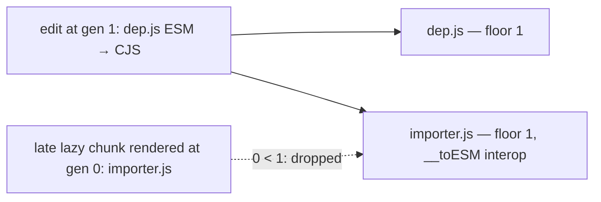
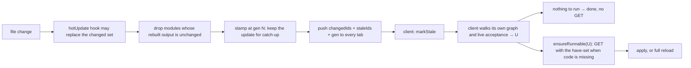
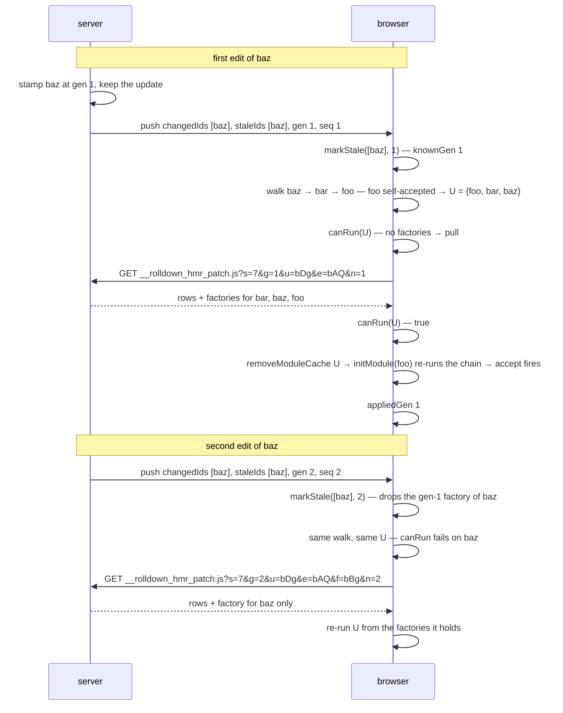

# Client-Side HMR — Design & Principles (Full Bundle Mode)

> **Implementation map** — the server-side step order lives in
> [dev-engine/implementation.md](../dev-engine/implementation.md)
> ("Inside `compute_hmr_update_for_file_changes`" and "Inside
> `render_patch`"); the lazy chunk path in
> [lazy-compilation/implementation.md](../lazy-compilation/implementation.md).

## Summary

In Full Bundle Mode (FBM, `bundledDev` in Vite code), HMR decisions
happen in the browser, and the browser also asks for the code it needs.

On a file change the server rebuilds the changed modules and pushes one
message to every tab. The message has ids only, no code:

- `changedIds` — the modules that changed (the seed of the client walk)
- `staleIds` — every module whose factory the rebuild made outdated
- `gen` — the number of this rebuild
- `seq` — a per-connection counter that Vite adds

The client walks its own graph and finds the **update set** `U`: the
modules that run again. If it lacks code to run `U`, it makes one GET for
a patch. The query of that GET describes the client: which engine it
talks to, the newest rebuild it knows, `U`, the modules it executed, and
the factories it holds of modules it did not execute. The server answers
from that request alone. It keeps no record of any tab.

Two client stores make this possible:

- the **module factory map**: re-runnable module code (`registerFactory`)
- the **module graph**: rows sent as compiler data (`registerGraph`,
  `crates/rolldown/src/hmr/module_graph_delta.rs`)

The server keeps one engine-wide record, the **HMR session**
(`HmrSession`, `crates/rolldown_common/src/hmr/hmr_session.rs`): the
epoch, the generation, a stamp per module, a number per module, and the
last 64 updates.

Terms used below:

- A **payload** is any code the server sends: the entry chunk, a lazy
  chunk, or a patch.
- A **client** is one browser tab.
- A **stamp** is the number of the rebuild that last changed a module's
  rendered factory. A module that never changed has stamp 0.
- The **generation** (`gen`) is the number of the newest rebuild that
  stamped any module.

The runtime store is exported as `rolldown/experimental/runtime`; the
Vite client subclasses it and installs the HMR hooks
(`packages/vite/src/client/bundledDevClient.ts`). The HMR judgment
itself lives in Vite's `BundledDevHMRClient`
(`packages/vite/src/shared/bundledDevHmr.ts`).

This document records the reasons: why the boundary is computed on the
client, and why the client describes itself in the request instead of
the server keeping a record of it.

## The core split: each side owns only what it can observe

- The **client owns its state**: the module cache (= the executed set),
  the factory map, and acceptance (`hot.accept` registrations). Only the
  client knows these exactly, and only at the moment it reads them.
- The **server owns sources and history**: the module graph, the module
  code, the stamps, the generation, the module numbers, and the recent
  updates. It holds nothing about any single client.
- **The client describes itself only when it needs code.** It sends its
  state as part of the patch or lazy request it makes anyway. The
  protocol has no hello session, no delivery ack, and no state report
  ahead of time.

The messages are:

| Direction       | Message                     | Carries                                         |
| --------------- | --------------------------- | ----------------------------------------------- |
| server → all    | push (`bundled-dev-update`) | `changedIds`, `staleIds`, `gen`, `seq`          |
| client → server | patch GET                   | epoch, known gen, `U`, executed set, factories  |
| client → server | payload map GET (devtools)  | the id of a sourcemap Vite served a link to     |
| client → server | lazy GET (`/@vite/lazy`)    | proxy id, epoch, known gen, executed, factories |
| client → server | reload request              | the reason                                      |

Every principle below follows from this split.

## Design principles

### 1. Boundary computation runs on the client

Whether a module has **executed** decides where the boundary is: an
importer that never ran cannot accept anything. Only the browser knows
this exactly. Rejected: keep the computation on the server and have
clients report which modules ran. Reports have no barrier — at change
time the server only knows what has already arrived. Example: a tab
opens a route and `settings.js` runs. The user saves `settings.js`
before the tab's report reaches the server. The server thinks the module
never ran and computes a wrong update. No protocol change removes this
timing gap.

On the client the check is a module cache lookup (`isExecuted`). Every
payload kind enters a module into the module cache before the module's
own statements run, so the module cache _is_ the executed set — exact,
per client, nothing to wait for. Multiple tabs need no extra work.

The same rule covers `import.meta.hot.invalidate()`. No rebuild
happened, so there is no push. The client walks from the caller's
executed importers on its own, runs `ensureRunnable` (principle 5) on
the result, and applies it (`applyInvalidate`). The walk remembers
which module called `invalidate()` (`firstInvalidatedBy`); an update
that comes back to that module is a full reload, not a loop.

### 2. The client describes itself in the request, at the moment of need

The server needs to know what a client lacks before it can render code
for it. The client tells it, inside the GET it makes to load that code:

```
/__rolldown_hmr_patch.js?s=<epoch>&g=<knownGen>&u=<U>&e=<E>&f=<F>&n=<nonce>
```

- `u` — the update set `U`
- `e` — the executed modules (module cache keys) minus `U`
- `f` — the modules whose factory the client holds and that are not in
  `e`. A module in `e` keeps its exports, so the server never reads its
  factory. In lazy mode almost every factory belongs to a module that ran,
  so `f` is short.
- `n` — a nonce, so each URL is new (the browser keeps one module record
  per URL)

An empty set is left out. So is `g` while the client does not know it
(principle 3).

The client builds this query right before the GET, after `markStale`
(principle 4). So it is exact at the moment the server reads it. Nothing
can land between "the client reported" and "the server rendered", because
the report and the request are the same message.

The server reads the request with `holds_current` and
`collect_unheld_sync_deps` (principle 7) and carries exactly the code
the client cannot run without.

The cost is the same as a server that keeps a record and pushes code:
one push and one GET per update. A client whose walk finds nothing to do
makes no GET at all.

Rejected: **a server-side record per tab** of which factories landed
there, written from a delivery ack that each payload sends back. Its
problems:

- The record is always behind the client. It needs acks, a pending
  list for payloads that were rendered but not yet acked, and rules for
  a payload that throws before its ack.
- The server does not know `U` at push time. It must predict `U` with
  its own importer walk on static accept data, and render one patch per
  tab before the push goes out. A wrong prediction costs bytes (too
  much) or a reload (too little).
- A new tab has no record. The server must guess what the entry chunk
  ran from the static output, and the guess is wrong when the tab loaded
  an older output than the latest build.

Rejected: **render the patch for every tab at push time**. It needs the
per-tab record above, and it renders code that a tab whose walk is a
no-op never fetches.

### 3. The module graph ships as compiler data

The client walk needs the import graph. Webpack learns it by
intercepting every `require`; FBM cannot — the bundle stays
**scope-hoisted** (all modules share one function scope, as in prod, so
there is no per-module wrapper call to hook). Instead, every payload
has one `registerGraph(delta)` statement with one graph row per module
in the payload: its static and dynamic `import()` edges, in separate
sets, unioned by `getImporters`. The client merges deltas into one flat
graph; the newest row for a module replaces the older one. A common
chunk inlined by `experimentalInlineCommonChunks` registers its
modules' rows from its factory (see
[inline-common-chunks/design.md](../inline-common-chunks/design.md#dev-mode)).

Each row set also carries what the request needs (principle 6):

- `nums[i]` — the session number of `ids[i]`, for every id: rows and
  foreign edge targets. So the client can name an `import()` target it
  has no row of yet (principle 5)
- `epoch` — the engine's epoch, on full-build rows only. A payload's
  request already proved the epoch.

A payload's rows get the payload's generation from its first statement,
`beginPayload(G)` (principle 7). Full-build rows carry no generation, so
the full-build output does not change when only the generation moved.
Example: an edit and its undo give an entry chunk that is byte for byte
the first one, and the browser reuses the code it compiled for it (V8
keeps compiled code per script content). With `gen` in the rows, the
undo would change one number in a 5 MB bundle, and the page would
compile all of it again. The engine gives the generation with the output
instead (`BundleOutput::hmr_generation`, the second argument of the dev
engine's `onOutput`). The server tells it to the client that
loads this output, and the client calls `runtime.setOutputGeneration(gen)`
before the first push:

- **Browser.** Vite puts it in the HTML it serves, as
  `<meta name="vite-bundled-dev-generation" content="N">`
  (`indexHtml.ts`, from `BundledDev#outputGeneration`), and the Vite
  client reads it at boot (`bundledDevClient.ts`). The HTML etag comes
  from the HTML with the tag. The page fetches the HTML before the
  chunks, and the output only moves forward, so the generation in the
  HTML is never newer than the code the page runs. An older one only
  costs a catch-up. A meta tag, not an inline script, so a page with a
  CSP needs no nonce for it.
- **Module runner.** `fetchModule` returns the generation with each
  output chunk (`rolldownGeneration`). The first chunk the runner fetches
  is the entry, and the runner calls `setOutputGeneration` with it. Until
  then the runner's generation is unknown, and a push only marks modules
  stale. The entry can be older than such a push. So when the entry ran
  and `missedUpdate()` holds, `ModuleRunner#import` pulls the catch-up
  and applies it before it returns (principle 4).
- **No generation.** A page whose HTML Vite did not serve (backend
  integration) has `knownGen = -1`. Its requests leave out `g`, and Vite
  fills in the generation of the output it serves now, which is most
  likely the output the page loaded. The client takes the generation from
  the answer's `beginPayload(G)`. After a push the client pulls once even
  when it can run the update, so it learns the generation early. Limit:
  an update pushed after the page loaded and before it connected,
  followed by a rebuild of the output before the first request, is not
  caught up.

Example: the page loads the output of gen 3, and its HTML says 3. The
user saves `a.js` before the page connects. The push of gen 4 does not
reach it. Then the user saves `b.js`, and the page gets the push of gen 5.
It is not 3 + 1, so the page asks with `g=3`, and the catch-up brings the
change of `a.js`.

A row also says whether its module is an entry (`isEntry`). The page
started each entry, and only a page load starts it again. So when an
update removes an entry from the module cache and no boundary runs it
again, the client reloads. A module that is not an entry and has no
importer that ran is no longer imported, so the update stops there.
Webpack records a similar fact at run time (`module.hot._main`: no
parent's `require` ran the module first). FBM has no `require` call to
watch, so the compiler sends the flag.

Rejected: an edges argument on `registerModule` (the call that enters a
module into the module cache). A module registers itself only when it
runs, so those edges would exist only for modules that ran — but the
walk needs the full static graph. When the walk reaches a module whose
importers never ran, it must know whether importers exist at all: "no
importers" and "importers exist but none ran" are the same reload
reason, but the check needs the edges to say so. Per-module edges also
cost more bytes: each row would repeat its importer ids as strings,
while the delta interns each id once.

### 4. `markStale` keeps held factories current

A push lists `staleIds`: every module the rebuild stamped. That is the
changed modules, the modules the rebuild added, and the importers whose
factory changed because an importee's interop facts changed (principle
7). `changedIds` is only the walk seed and is often smaller.

On every push the client runs `runtime.markStale(staleIds, gen)`, also
when its walk finds nothing to do. For each id whose factory value
(`factoryGens`: the larger of the generation of the installed factory and
the floor) is below `gen`, it deletes the factory and sets the value to
`gen`.

It raises `knownGen` to `gen` only when `gen` is `knownGen + 1`.
Generations are consecutive: each `Changed` update and each engine full
reload adds exactly 1 (`begin_rebuild`, `begin_full_reload`). So a push
that skips a generation means the client missed an update: it was pushed
before the client connected, or it was an engine full reload, which
sends no push. Only the server knows what a missed update changed. So
`knownGen` stays, `pushedGen` records the push, and `ensureRunnable`
pulls while `pushedGen > knownGen`, also when the update can run. The
answer is a catch-up (principle 6), or Reload when the missed update
was an engine full reload or is no longer kept. A client that ran no
module yet does not pull: it has nothing to catch up.

A push that lands before the page ran its output does not raise
`knownGen` either. The Vite client script runs before the chunk scripts,
so the WebSocket can deliver a push while a large entry chunk still
loads. That entry then runs the code from before the push. So the
runtime raises `knownGen` only after full-build rows registered
(`epoch` is set). Until then the push counts as missed. Module scripts
run before `DOMContentLoaded`, so on that event the Vite client calls
`catchUpMissedUpdates`: when `missedUpdate()` holds, it pulls the
catch-up and applies it, as for any missed update. The module runner
does the same in `ModuleRunner#import`, after its entry ran and before
`import()` returns.

Example: the HTML says gen 3. The user saves `a.js`, and the push of
gen 4 lands while the entry chunk downloads. `knownGen` stays 3. The
entry runs the old `a.js`. On `DOMContentLoaded` the client asks with
`g=3`, and the catch-up brings the change of `a.js`.

This gives two rules:

- **Every held factory is current as of `knownGen`.** So `f` in the
  request means "current copies", and the server can check it with one
  comparison: `holds_current(m) = f.has(num(m)) && latest[m] <= g`. A
  skipped generation does not raise `knownGen`, so this rule holds after
  a missed update too.
- **The push's `gen` is a floor.** `registerFactory` drops a copy from a
  payload rendered at an older generation. A payload rendered before the
  update, landing after the push, cannot install an old factory.

Example: the tab holds a factory of `baz.js` from a payload of gen 1. A
push says `staleIds: ["baz.js"], gen: 2`. The runtime deletes the factory
and sets the floor to 2. A lazy chunk that the server rendered just
before the rebuild lands next, at gen 1. `1 < 2`, so its `baz.js` is
dropped. The next request sends `f` without `baz.js`, and the server
carries the new copy.

That works when the next request walks to `baz.js`. A dropped factory of
a module that did not run, but that a module which ran imports
statically, is different: a `require()` inside a function of `a.js`
runs `b.js` later, and synchronously. No walk reaches `b.js`, because
`a.js` keeps its exports. So `markStaleAt` records such a module in
`droppedDeps`, and the next pull names it as a root in `u`. When the
update needs no pull, the Vite client calls `runtime.refetchDropped()`
after the update, in the background: one pull at a time. A module is
recorded when `markStale` moves its floor. An earlier drop that a pull
still carries is not lost: it goes back when the pull settles.

A pull takes the ids out of `droppedDeps`. When it settles, with a
payload, a Reload body or a failure, each taken id that still has no
factory, did not run, and has an importer that ran goes back. A refetch
runs a second time when its pull put ids back and its payload was newer
than the payload before it. Example: a refetch payload rendered at gen 3
lands after the push of gen 4 for the same module, so its copy is
dropped; the second run gets the gen-4 copy. If a pull fails, the
`require()` later finds no factory, and the page reloads (Failure
policy).

A push at or below `appliedGen` (the newest generation the client
already applied) only runs `markStale`. The client does not walk again.

### 5. `ensureRunnable` fetches before anything is removed

Every factory calls `initModule` on each static dep before its body, and
`initModule` is synchronous. So the whole static closure of what will
run must be in place before the update removes anything from the module
cache. `runtime.ensureRunnable(U)` makes sure of that:

1. `canRun(U)` follows static rows from every module in `U`. Members of
   `U` count as not executed, because the update removes them. A module
   that executed and is not in `U` stops the walk: its exports stay
   live. Any other module it reaches needs a row and a factory.
2. If `canRun(U)` is true, the update applies.
3. Otherwise the client imports `patchUrl(U)` (principle 2) and checks
   again. After two pulls it gives up and asks for a full reload.

A second pull is needed only when the client changed while the first
payload was on the way, for example a newer push marked a carried
module stale. The second request describes the client as it is then.

**Plain `import()` in a factory.** A factory compiles a plain (not lazy)
`import()` to `__rolldown_runtime__.loadDynamic(id)`. The target is not a
static dep, so neither `canRun` nor `collect_unheld_sync_deps` follows
it, and the payload that carried the importer did not carry it. The
client may have never run it nor received its factory: it is new, or it
sits in a full-build chunk the page never loaded. `loadDynamic` runs the
target when `isRunnableHere(id)` holds and `missedUpdate()` is false. A
client that missed an update must not run a factory it holds before the
catch-up, so it pulls first; `requestLazy` has the same rule. Otherwise
it imports `patchUrl({id})`: the target is the update root. It did not execute, so
it is not in `e`, and the server carries it and its unheld static deps
like any root. Then it checks again, with the same two-pull limit, and
runs the target. Example: an edit adds `import('./route.js')` to a
self-accepting module, and `route.js` is in a chunk the page never
loaded. The patch carries the module only. When the `import()` runs,
the client pulls `route.js` and its static deps that it never ran. A
CommonJS target keeps its interop at the call site:
`loadDynamic(id).then(() => __toESM(loadExports(id)[, 1]))`. The
full build is scope-hoisted and keeps its own `import()` code.

Limit: with `devMode.lazy: false`, the pulled target may sit in a
full-build chunk the page has not loaded yet. When the full build later
runs its own `import()` of that chunk, the chunk runs the module a
second time: it registers a new instance, and the importer that called
`loadDynamic` keeps the first one. `registerModule` warns when this
happens. Lazy mode does not have this problem, because a page gets
scope-hoisted code only at boot.

If a payload brought a catch-up (principle 6), `ensureRunnable` returns
`caught-up` with the extra changed ids. The Vite client walks again with
them added and calls `ensureRunnable` once more. A second `caught-up` is
a full reload. After apply, the client sets `appliedGen` to the
`knownGen` it had when `ensureRunnable` returned `ready`. For
`import.meta.hot.invalidate()`, the caught-up ids are walked without
`firstInvalidatedBy`: a new edit of the module that invalidated is a
normal update, not an update that propagated back to it.

A catch-up can also come with a request outside an update: a lazy
chunk, a `loadDynamic` pull, or a refetch. Then no walk is waiting for
it. So once the request settled (the requested module ran, or the
request failed after the catch-up landed), the runtime calls
`hooks.onCaughtUp()`, and the Vite client queues an update with the
caught-up ids (`catchUpMissedUpdates`). The new module ran against the
old code of those modules for that short time, as a module that runs
right before a push does.

Lazy loads and `loadDynamic` are not queued behind the update. A module
can run while the client waits for a pull or for a `vite:beforeUpdate`
listener, and it binds the exports of the modules it imports at that
moment. If it imports a module of the update, it must be in the update
too. A catch-up that lands in the same wait can also drop a factory of
the update. So the runtime counts `registerModule` calls:

- after `ready`, a changed count makes the client walk again;
- right before the client removes the update from the module cache, in
  the same synchronous step, it checks the count and `canRun(U)` once
  more. If the count changed or `canRun(U)` is false, it prepares the
  update again (at most three times, then a full reload).

### 6. Numbers, epoch and generation make the request small and safe

- **Module numbers.** Every module gets a number on first sight. Numbers
  are append-only for the whole engine life: a full build, a cache clear
  or a lazy compile never reuses or moves one. Rows carry them, and the
  client sends sets of modules as sets of numbers. A module with no
  number is left out; the server then counts it as not executed and not
  held, which can only add bytes.
- **Set encoding.** A set is `b` and a bitset: bit `i` is set for number
  `i`, bytes in little-endian bit order, base64url without padding.
  Example: `{0, 3, 8, 17}` is the bytes `09 01 02`, sent as `bCQEC`. A
  bitset costs about `n / 6` characters, where `n` is the highest number
  in the set.
- **Decoding limits.** The server parses the sets in
  `crates/rolldown_common/src/hmr/client_have.rs`, with the session's
  number count. It rejects a set with another prefix, a set that names a
  number at or above that count, and input longer than any valid set of
  the session. The decoded set is a bitset of at most `count / 8` bytes,
  whatever the input. A rejected query is a Reload ("the query does not
  parse" below).
- **Epoch.** Each `DevEngine` picks a random nonzero `u32`. A tab that
  survived a dev server restart has numbers that mean other modules in
  the new engine. Its epoch does not match, so it reloads.
- **Generation.** A new page starts with `knownGen` equal to the
  generation of the output it loaded (`setOutputGeneration`, principle
  3). A push raises it by one, and a catch-up to the server's
  generation (principle 4).

**Catch-up.** A request can reach the server after a rebuild that the
client has not heard of yet (its push is still on the way). The payload
is rendered from the current graph, so its factories may expect the
newer modules. The session keeps the last 64 `Changed` updates (ids
only). When `g` is older than the session's generation, the payload
has one statement right after its prelude:

```js
__rolldown_payload__.catchUp([
  { gen: 4, changedIds: ['b.js'], staleIds: ['b.js'] },
  { gen: 5, changedIds: ['a.js'], staleIds: ['a.js', 'x.js'] },
]);
```

It lists the kept updates with a generation in `(g, G]`, oldest first,
and each entry acts like the push the client missed: the runtime marks
its stale ids stale at the entry's `gen`. Each id is listed only under
the newest entry that names it, so its floor is its current stamp. An
entry with no ids left is left out, and so is an empty `changedIds`. The
changed ids of entries newer than `appliedGen` go to the caller of
`ensureRunnable` (principle 5). The runtime keeps each such id with the
generation of its entry, and drops it once `appliedGen` reaches that
generation. Example: the update of gen 2 is `ready`, and the client
waits for a `vite:beforeUpdate` listener. A lazy chunk asked for at
`g=1` lands then, with the change of `a.js` at gen 2. The update of gen
2 runs `a.js` and sets `appliedGen` to 2, so `a.js` is not walked a
second time.

One `gen` per entry, not one for the whole catch-up: two requests from
the same old `g` can be rendered on both sides of a rebuild. With one
catch-up gen, the newer payload's catch-up would drop a current factory
that the other payload installed.

The server answers **Reload** instead of a payload when:

- the epoch does not match
- `g` is newer than the session's generation
- an update after `g` is no longer kept (the session keeps 64), or `g`
  is older than the last engine full reload (Failure policy). Both set
  one floor, `min_client_gen`: a `g` below it reloads.
- the query does not parse
- no build has a module graph

Reload must always end in a page reload. A failed import cannot say
that: for a lazy or plain `import()` it only rejects the user's
promise, the same as a compile error (HTTP 500). So Vite serves a
Reload with status 200 and this body, on the patch route and on the
lazy route:

```js
__rolldown_runtime__.reloadNeeded('the epoch does not match');
export {};
```

`reloadNeeded` calls `hooks.onReloadNeeded(reason)` once. The Vite
hook requests a reload (Failure policy), and the standalone runtime
calls `location.reload()`. After that, the runtime sends no more
requests: `ensureRunnable` returns `reload`, and a `requestLazy` or
`loadDynamic` call rejects.

**Request size.** Node's default `maxHeaderSize` is 16 KiB for the
request line and all headers, and Vite keeps it. Each set costs about
`n / 6` characters, so three dense sets pass that limit at about 30,000
module numbers. Such a request fails with 431: an update then reloads,
and a lazy load rejects the user's `import()`. See Unresolved Questions.

`encodeHave` builds each set as a bitset. The runtime keeps the ids of
the factories of modules that did not run (`factoriesNotRun`), so `f`
does not walk every factory.

### 7. Patches carry only what the request lacks; the payload generation keeps the newest copy

`render_patch` (`hmr_stage.rs`) carries:

- each module of `U` that the client does not hold current
  (`!holds_current`)
- the static deps that `collect_unheld_sync_deps` finds, walking from
  every module of `U` on the current graph:
  - a dep in `e` and not in `U` stops the walk (its exports stay live)
  - a dep the client holds current is walked through, not carried
  - any other dep is carried and walked through

An id of `U` that is no longer in the graph is skipped. The client's
`canRun` then still fails, and it reloads.

A patch is self-contained: it answers one request, not "everything since
the last patch". So patches have no order among themselves. Vite's
`seq` still orders the pushes on one connection; a gap is a reload.

Payload layout:

```js
const __rolldown_payload__ = __rolldown_runtime__.beginPayload(5);
__rolldown_payload__.catchUp([{gen:5,changedIds:["b.js"],staleIds:["b.js"]}]);
__rolldown_payload__.registerGraph({ids:["b.js","c.js"],localCount:1,edges:[[1]],nums:[4,9]});
//#region b.js
__rolldown_payload__.registerFactory("b.js", (function(__rolldown_module_id__) { … }));
//#endregion
```

- **Prelude.** `beginPayload(G)` is the first statement of every payload
  that is not a Reload body, also of one that carries nothing. `G` is the
  session's generation, read while the payload renders.
- **Catch-up.** Optional, right after the prelude (principle 6).
- **Rows.** Optional. They carry no generation, no stamps and no epoch.
- **Factories.** One `//#region` per carried module, sorted by module id.
  The factory text never contains `G`.
- There is no tail statement: the client runs the update.

`__rolldown_payload__` is a binding of the payload module, so each
payload's calls carry its own `G`, and no runtime state is set and reset
between payloads.

**On the wire every number is a generation.** The server keeps a stamp
per module (`HmrSession.latest`) for `holds_current` and for the catch-up,
but no stamp goes to the client. Registration keeps the newest copy:
payloads can land out of render order, for example a lazy chunk rendered
before an edit can land after the patch for that edit. The runtime keeps
`rowGens` and `factoryGens`, and drops a row or a factory from a payload
older than the one it holds or than the floor `markStale` set.

This is as exact as a stamp per module. Every floor a client sets is a
generation at which that module was stamped: a push's `gen`, or a
catch-up entry's `gen`. All renders and stamps run under the bundler
lock, so the stamp of `m` in a payload of generation `G` is the largest
stamp of `m` at or below `G`. For any floor `f`, `G >= f` holds exactly
when that stamp is `>= f`. When two copies have the same stamp, the newer
render wins, where stamps would let the later arrival win.

Example: `x` imports `y`. At gen 5, `y` adds `acceptExports`, so the row
of `x` now lists the names it imports from `y`, but `x` is not stamped.

```
P rendered at G=5: row of x has bindings for y   -> lands first
L rendered at G=4: row of x has no bindings      -> lands last
gens: 4 < 5, so L's row is dropped and P's row stays
```

An importer's factory also reads facts about each importee: its
`exports_kind` and whether it has a lazy export. These choose the
interop code (`__toESM`, `__toDynamicImportESM`). So when an edit
changes them, the update stamps every importer of that module too and
lists it in `staleIds`, even though the importer's own source did not
change. It does not add the importer to `changedIds`, so no client
re-runs it for this reason.

Example: `importer.js` imports `dep.js`, and an edit at gen 1 turns
`dep.js` from ESM into CommonJS. The push lists both in `staleIds`. A
client that holds `importer.js` drops it, and its next request gets the
new copy with the `__toESM` interop. A lazy chunk that was rendered
before the edit (gen 0) still has the old `importer.js`, so the runtime
drops it when it lands late.



Full-build chunks call `__rolldown_runtime__.registerGraph(delta)`
directly, with no generation. They run their code right away, so their
rows always replace the old ones. They reset only `rowGens`: a late stale
factory must still not install.

Each pull renders the factories it carries. The name that holds an
importee's namespace in a factory depends only on the importer and the
import record, not on the payload, so a factory's text is the same in
every payload that carries it (see `hmr_import_binding_name` in
`hmr_ast_finalizer.rs`).

**Payload sourcemaps.** A patch and a lazy chunk have no file, so the
engine returns their map as JSON (`sourcemap: true`), and Vite links it
instead of inlining it: it keeps the maps it served lately
(`PayloadMapStore`, at most 256 maps and 64 MiB, the least recently used
go first) and adds `//# sourceMappingURL=<base>__rolldown_payload_map_<id>.map`.
The browser downloads a map only when devtools asks for it. The URL sits
next to the output files, because the map names its sources relative to
the out dir. A map that was dropped gives 404: devtools shows the code
without its sources.

- Patches and lazy chunks have one store each (ids `p<n>` and `l<n>`).
  A lazy chunk's code runs for as long as the page uses its route, so
  many patches must not drop its map.
- A map that is already stored keeps its id. Tabs in the same state get
  the same payload, so N tabs cost one entry.

### 8. The runtime is a store; HMR judgment lives in the Vite client

`__rolldown_runtime__` (`DevRuntime`) holds graph rows, the module
cache, and the factory map, with lifecycle methods, read-only queries,
and the request helpers (listed under Related). It makes no boundary or
reload decisions. The walk, acceptance record, dispose/data, apply
queue, and reload decision live in `BundledDevHMRClient` on the Vite
side, connected through hooks (`createModuleHotContext`,
`onModuleCacheRemoval`, `onMissingFactory`, `onReloadNeeded`,
`onCaughtUp`). Reason: acceptance is
recorded where `accept()` executes — the hot context, a Vite object —
and the walk must read that record and the graph in one consistent
snapshot. Keeping both in one object means the walk can never pick a
boundary from static data that the module did not accept at runtime.

The runtime owns what the request needs, because it owns the stores the
request describes: `beginPayload`, `markStale`, `catchUp`, `canRun`,
`ensureRunnable` and `encodeHave`. The URL methods `patchUrl(query)` and
`lazyUrl(proxyModuleId, query)` build the request URLs. Vite overrides
them for its base path. Its module runner overrides `importPatch` and
`loadLazyChunk` to load through the runner. A full reload of the runner
replaces its runtime, and a request of the old runtime can still be on
the way. So the runner runs each payload against the runtime that asked
for it (`_importPayload` in `runner.ts`), and the hooks of a replaced
runtime do not ask for a reload. The Node test client overrides
`importPatch` too.

The runtime is a plain export (`rolldown/experimental/runtime`), and
Vite extends the class instead of patching it. The `vite:beforeUpdate`
and `vite:afterUpdate` listener payloads mirror bundleless Vite's
`js-update` entries, one per boundary, so plugin listeners keep working.
Rolldown's own tests carry a smaller copy of the Vite walk in
`crates/rolldown_testing/src/hmr-runtime.js`. It has partial accept
(`acceptExports`) like the Vite walk. It differs from it in three ways:

- a module with no executed importer ends the walk with a full reload,
  and the test client throws on it, because an executed fixture asserts
  hot updates. Vite's walk stops there and goes on with the update.
- it has no entry check (`findEntryWithoutBoundary`), which reloads when
  the update removes an entry that no boundary runs again
- it does not walk again when a module registers during the update
  (`registerCount`)

The integration harness runs it in a live Node client per fixture
(`crates/rolldown_testing/src/hmr_test_client.rs`): each push goes to the
client, each pull goes to `DevEngine::render_patch`, and the snapshot
records the decoded request and the patch. The client runs the catch-up
statement and the Reload body as a page does: the fixture option
`dev.lostPushSteps` keeps a push from the client, so its next pull has an
old `g` (`catch_up_after_lost_push`, `reload_after_lost_full_reload`). A
fixture that runs no client (`expectExecuted: false`) still gets one pull
per `Changed` update, made by the harness: it says it ran every module of
the last full build and holds no factories.

### 9. One factory shape — re-execution is module cache removal

The same factory code serves the first run and every re-run; the
runtime never emits a second variant. `initModule(id)` skips a module
already in the module cache and runs the factory otherwise. Whether a
module re-runs is decided by whether the updater first removed it from
the module cache: the HMR apply removes the update set (those re-run);
a lazy chunk removes nothing (shared modules are skipped). Rejected: a
per-payload re-run flag written into the generated code — that puts
runtime policy into codegen and cannot express "re-run this time, skip
next time".

A lazy `import()` goes through the same gate (`requestLazy`, see
[lazy-compilation/design.md](../lazy-compilation/design.md)). Removing
a module from the cache also forgets its cached lazy load, so a lazy
module edited after it loaded re-runs instead of being served from the
old promise.

`removeModuleCache` is also where cleanup lives: each removal runs the
module's `hot.dispose` with its `hot.data` object — for every removed
module, not only the boundary. This is the webpack-style whole-chain
dispose. Disposing only the boundary is a known leak; upstream confirmed
it was not intended. The `hot.data` object is kept, so the re-run module
reads what `dispose` stored in it, as in bundleless Vite.

### 10. The server shapes the changed set; it does not walk importers

The server has no importer walk and no accept data in its decisions. It
computes the changed set, stamps it, and pushes ids. Two steps shape the
changed set first. Both edit the seed only; the client-side decision is
unchanged.

- **The `hotUpdate` plugin hook** runs first. A plugin may replace the
  changed set for a file — a config file that affects many modules, a
  content file that is not a module at all. The hook runs only when the
  `experimental.devMode.hotUpdate` input option or the `dev.hotUpdate`
  option is on (off by default, see Unresolved Questions). Vite forwards
  `experimental.devMode` from the user config, but not `dev.hotUpdate`.
- **Unchanged-output suppression** runs second. If a module's rendered
  output is byte-identical before and after the rebuild, it is dropped
  from the changed set. A save with no effective change no longer
  re-runs the module and discards its state. When nothing is left to
  stamp, the update is `HmrUpdate::Noop`, the generation does not move,
  and no client needs to act. Two cases are never dropped: everything
  after an errored build (clients stuck on the error overlay must receive
  the recovery), and modules a `hotUpdate` hook returned (the change may
  live outside the module's own code, so identical output proves
  nothing).

The rules of both steps are in
[dev-engine/implementation.md](../dev-engine/implementation.md).



## Failure policy

Full reload is the fallback for these delivery and state failures:

- `canRun(U)` still false after two pulls
- a patch or lazy request answered with Reload (principle 6)
- a failed patch import of an update: a compile error (HTTP 500) or a
  network error
- `seq` gap
- no executed importer on the walk
- an `invalidate()` walk that returns to its caller
- a boundary inside an import cycle that throws on re-run (the cycle's
  execution order cannot be recovered; same rule as bundleless Vite)
- a factory missing at `initModule` time: the runtime calls
  `hooks.onMissingFactory(id)` before it throws `MissingFactoryError`,
  and the Vite hook requests a reload. `requestLazy` does the same when
  the module is still not runnable after two lazy loads, and
  `loadDynamic` when its target is still not runnable after two pulls.

A failed lazy load or a failed `loadDynamic` pull is not on this list.
It rejects the user's `import()` and does not reload, like a failed
`import()` in bundleless Vite.

A factory that throws outside a cycle stays in the module cache
(principle 1). The throw is the application's own runtime error: HMR
does not classify or recover from it. The apply queue logs it as a
failed update, and the next edit re-runs the module normally.

The client does not reload itself for HMR failures. It sends
`vite:bundled-dev:reload-needed` with the reason. The server sends
`full-reload` to that client only, debounced, and holds it while a
build error is on screen so the overlay is not replaced by a broken
page. One exception: on the first update after the page loaded with a
build error already on screen, the shared Vite client hook
(`clearOverlayOrReloadOnFirstUpdate`) reloads directly, because the
page never fully loaded.

The engine emits a full reload on its own only when the graph must be
rebuilt from scratch: a tsconfig change, or an update that failed after
it merged its edit into the graph, so no client received the edit
(`bundling_task.rs`). Modules can change on this path with no stamp. So
before the reload goes out, the session advances the generation, drops
the kept updates, and refuses any `g` below the new generation
(`begin_hmr_full_reload`). A tab that still runs the older output gets
Reload from its next request instead of a patch built on wrong stamps.

The engine full reload adds 1 to the generation and sends no push. So
the next push skips a generation, the client pulls with its old `g`, and
the server answers Reload (principle 4). A page that gets no later push
still runs the older output, so Vite keeps the reload pending until a
build succeeds, also across failed builds (`fullReloadPending` in
`bundledDev.ts`, tested in `bundledDev.spec.ts`).

Vite's server sends its own reload in two more places. Once after the
initial build, for the fallback page. And when a page request finds the
output stale or the last HMR stage failed
(`triggerBundleRegenerationIfStale`, called from the HTML middleware);
nothing happens until a client requests the page.

## Worked example

Chain `app → foo → bar → baz`, `foo` self-accepts. The page loaded the
entry chunk. Its rows gave the numbers `app=0, foo=1, bar=2, baz=3` and
epoch 7, and the server told the page that the output is at gen 0. The
entry chunk is scope-hoisted and registers no factories, so the client
holds none.



The first request, decoded:

| Key | Value | Set                                       |
| --- | ----- | ----------------------------------------- |
| `s` | `7`   | epoch 7                                   |
| `g` | `1`   | known generation 1                        |
| `u` | `bDg` | bitset byte `0b1110` → `{1, 2, 3}` = `U`  |
| `e` | `bAQ` | bitset byte `0b0001` → `{0}` = `app` only |
| `f` | —     | left out: no factories                    |

The first patch (factory bodies left out):

```js
const __rolldown_payload__ = __rolldown_runtime__.beginPayload(1);
__rolldown_payload__.registerGraph({ids:["bar.js","baz.js","foo.js"],localCount:3,edges:[[1],[],[0]],nums:[2,3,1]});
//#region bar.js
__rolldown_payload__.registerFactory("bar.js", (function(__rolldown_module_id__) { … }));
//#endregion
//#region baz.js
__rolldown_payload__.registerFactory("baz.js", (function(__rolldown_module_id__) { … }));
//#endregion
//#region foo.js
__rolldown_payload__.registerFactory("foo.js", (function(__rolldown_module_id__) { … }));
//#endregion
```

In the second request `f=bBg` (byte `0b0110` → `{1, 2}`): the client holds
current factories of `foo` and `bar`. On the server both have stamp 0,
which is at or below `g=2`, so the server does not carry them. The patch
shrinks to the changed module.

If the second request had said `g=1` (the gen-2 push was still on the
way), the patch would start with
`const __rolldown_payload__ = __rolldown_runtime__.beginPayload(2);` and
`__rolldown_payload__.catchUp([{gen:2,changedIds:["baz.js"],staleIds:["baz.js"]}]);`.

## Unresolved Questions

- **Output that is only partly run** — `knownGen` counts the output as
  run once the first full-build rows set `epoch`. The output can still be
  only partly run then: a module waits on a top-level `await`, or the
  page has more module scripts. A push in that time raises `knownGen`,
  the walk skips the modules that did not run yet, and the update counts
  as applied. When those modules run later, they run the old full-build
  code, and `missedUpdate()` is false, so nothing catches up until the
  next edit of them.

- **Request size** — the sets are bitsets only, so a request of an app
  with more than about 30,000 module numbers can pass Node's 16 KiB
  header limit (principle 6).
- **Pulls during a rebuild** — a task that pushes an update and then
  rebuilds the output (`rebuildStrategy: 'always'`, or the recovery after
  a failed rebuild) holds the bundler lock for the whole build, so a pull
  that arrives after the push waits for that build.
- **One render per pull** — every tab that pulls after one edit renders
  the factories it needs again; nothing is kept between pulls.
- **Cold `__commonJSMin` wrappers** — a CommonJS module that a full-build
  chunk wraps in `__commonJSMin` runs only when first required. How a
  payload's code reaches such a wrapper that has not run yet is not
  settled.
- **CSS HMR** — CSS goes through the JS walk today: a style module
  re-runs and calls `updateStyle` through `import.meta.hot._internal`
  (untyped, marked TODO in `bundledDevClient.ts`). `hot.prune`, the
  `css-update` message, and module cache removal for styles are
  unspecified. `hot.prune` callbacks never run in FBM, because the
  server never sends a `prune` message.
- **`hotUpdate` gate** — the engine hook exists but stays off by default
  until file-to-module invalidation is complete (rolldown/rolldown#10714):
  the set a hook receives is not yet correct for query-variant modules.
  `experimental.devMode.hotUpdate` or `dev.hotUpdate` turns it on. Vite
  does not run its own `handleHotUpdate` / `hotUpdate` hooks in FBM yet.
- **Bundleless convergence (optional)** — bundleless Vite picks
  boundaries from static analysis; when the chosen module never
  registered a live `accept` callback, the update is dropped silently.
  Upgrading that to a reload would align the failure modes with FBM.

## Related

- [dev-engine/design.md](../dev-engine/design.md) — the dev engine that
  drives rebuilds and HMR updates
- [dev-engine/implementation.md](../dev-engine/implementation.md) — the
  step order inside `compute_hmr_update_for_file_changes` and
  `render_patch`
- [lazy-compilation/design.md](../lazy-compilation/design.md) — the
  `requestLazy` entry point; lazy requests carry the same have-set
- Runtime API (`runtime-extra-dev-common.js`): lifecycle methods
  `registerGraph`, `registerFactory`, `registerModule`, `initModule`,
  `removeModuleCache`, `loadExports`, `requestLazy`, `loadDynamic`;
  request methods `beginPayload`, `setOutputGeneration`, `markStale`,
  `missedUpdate`, `catchUp`, `ensureRunnable`, `refetchDropped`,
  `reloadNeeded`, `encodeHave`, `importPatch`, `loadLazyChunk`; request
  URLs `patchUrl`, `lazyUrl`; read-only queries `getImporters`, `isEntry`,
  `isExecuted`, `hasFactory`, `canRun`; hooks `createModuleHotContext`,
  `onModuleCacheRemoval`, `onMissingFactory`, `onReloadNeeded`, `onCaughtUp`
- Key code: `crates/rolldown_common/src/hmr/hmr_session.rs` (epoch,
  generation, stamps, numbers, catch-up),
  `crates/rolldown_common/src/hmr/client_have.rs` (the request format
  and its decoding limits),
  `crates/rolldown/src/hmr/hmr_stage.rs` (`render_patch`,
  `collect_unheld_sync_deps`),
  `crates/rolldown/src/hmr/module_graph_delta.rs`,
  `crates/rolldown_plugin_hmr/src/runtime/runtime-extra-dev-common.js`
  (the runtime store + executor),
  `crates/rolldown_testing/src/hmr-runtime.js` (test mirror of the walk)
- Vite side:
  - `packages/vite/src/shared/bundledDevHmr.ts` — the walk, apply
    queue, invalidate
  - `packages/vite/src/client/bundledDevClient.ts` and
    `packages/vite/src/module-runner/runner.ts` — runtime subclass +
    hooks, for the browser and for the module runner
  - `packages/vite/src/node/server/bundledDev.ts` — push broadcast with
    `seq`, reload requests, the Reload body; `renderPatch` and
    `triggerLazyBundling` fill in `g` when the query has none
  - `packages/vite/src/node/server/middlewares/bundledDevPayload.ts` — the
    patch route, the payload map route and its store
    (`PayloadMapStore`); `triggerLazyBundling.ts` — the lazy
    route; `packages/vite/src/node/ssr/fetchModule.ts` serves patches and
    lazy chunks to the module runner
