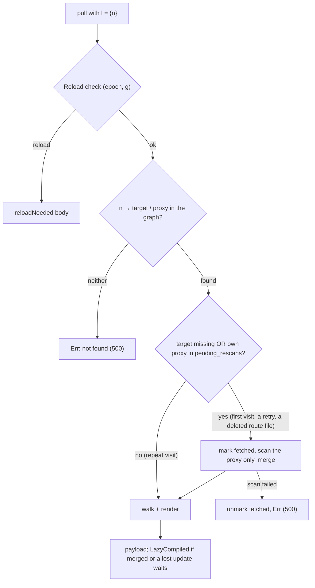

# Lazy Compilation — Design

> The implementation — data lifecycle, module-ID handling, end-to-end flow, and lessons learned: see [implementation.md](./implementation.md).

## Key Notes (TL;DR)

1. **Transparent UX** - `import('./module')` just works; the finalizer rewrites the import into a `requestLazy` call
2. **Dynamic imports only** - static imports always compiled immediately. Boundary creation is module-type-blind (see Scope)
3. **`requestLazy` entry point** - a lazy `import()` compiles to `__rolldown_runtime__.requestLazy(realStableId[, 1])`; when the client cannot run the module yet, the runtime makes an ordinary pull that names the module by its session number, then runs the module through the ordinary `initModule` gate
4. **Compilation granularity** - lazy module + the sync deps that the requesting client neither ran nor holds a current factory of; nested `import()` become new lazy boundaries
5. **One pull route** - a lazy load uses the pull route of HMR updates (`__rolldown_hmr_patch.js`), which returns the payload as a single JS string; the browser loads it as an ES module. The engine returns the sourcemap next to the code, or inlines it for `sourcemap: 'inline'` (see implementation.md)
6. **Module IDs** - runtime module-map lookups use **stable IDs** (cwd-relative). Emitted code and request URLs never contain an absolute path: a request names modules by session numbers. Absolute paths appear only in the fetched template's `import($MODULE_ID)`
7. **Proxy module states** - a proxy is a server-side graph node, never fetched as a chunk. Two states: **not fetched** (empty body, keeps the real module out of the build) and **fetched** (imports the real module, rooting the partial scan)
8. **No build after a compile** - a lazy compile merges the route into the graph and queues no build: no page loads a lazy route from the build output. The next build of any kind takes the route from the graph. A repeat visit of a fetched route also skips the scan (see [Repeat Visits](#6-repeat-visits))
9. **Dedup** - the server skips modules the client already ran or holds a current factory of, as the request says (`HmrStage::render_patch`); in the browser `initModule` runs a factory only when the module is not yet in the module cache — a shared module never executes twice
10. **Error handling** - the server reads only module numbers that it gave out, and looks them up in the graph (security gate, #9969). A route that does not compile answers HTTP 500: the `import()` rejects, a later `import()` asks again, and no error overlay shows. Init errors in lazy modules reject the consumer's `await import()` catchably (#9981)
11. **The request describes the client** - a lazy load is an ordinary pull. It carries the have-set of every pull, plus the target in the `l` set (see [hmr/design.md](../hmr/design.md), principle 2). The server keeps no state per tab
12. **After boot, only factories** - a page gets scope-hoisted code only at boot; every lazy route reaches it as factories, even a route the server compiled before (see [After Boot, Only Factories](#5-after-boot-only-factories))

## What is Lazy Compilation?

Lazy compilation is a **development optimization** that defers compilation of dynamically imported modules until they are actually requested at runtime.

### Goals

1. **Faster cold starts** - Only compile entry points and their synchronous dependencies on startup
2. **On-demand compilation** - Code behind `import()` is compiled just-in-time when the browser executes it
3. **Transparent to users** - No code changes required; `import('./foo')` should just work

## Enabling

Lazy compilation is opt-in, nested inside dev mode:

```js
export default {
  experimental: {
    devMode: { lazy: true },
  },
};
```

- `devMode` alone enables the dev/HMR machinery (`HmrPlugin`); `lazy: true` additionally prepends `LazyCompilationPlugin` before user plugins (`crates/rolldown/src/utils/apply_inner_plugins.rs`).
- The plugin's `context()` exposes the shared `fetched_entries` set as a `LazyCompilationContext`, which the `Bundler` keeps. `Bundler::render_patch` passes it to `HmrStage::render_patch`, which marks a proxy as fetched only when a lazy pull scans its route (see [Proxy Module States](#3-proxy-module-states)).
- rolldown-vite's bundled dev mode enables `lazy: true` by default.

## Scope

- **Dynamic imports only** (`import()`) - static imports are always compiled
- **Standalone feature** - Reuses the HMR runtime/rendering path for module output. A lazy pull itself emits no HMR update — but once fetched, the lazy module is an ordinary watched graph module, and later edits to it flow through the normal HMR pipeline (see implementation.md "Editing a fetched lazy module")
- **Module-type-blind boundary** - `resolve_id` proxies every dynamic import that resolves to a module in this build, with no extension or module-type filter, so the real target is not loaded until the first lazy pull. External resolutions are the exception: there is nothing to defer, and the dev runtime never gets a factory for an external, so `requestLazy` cannot run it. Config `external` and a plugin `resolveId` that returns `{ external: true }` both keep the original `import()` (#11273). Everything in the compiled unit must render as an ECMAScript AST:
  - **CSS** - unsupported in rolldown (removed, #4271); lazy compilation _defers_ the hard error from server startup to the first lazy pull (HTTP 500, catchable rejection at the consumer's `await import()`)
  - **JSON / text / base64 / dataurl** - currently broken inside lazy payloads: their exports are synthesized at link time, which the lazy render path skips, so they register empty exports until a rebuild + page refresh (see implementation.md Known Limitations)
  - **Binary assets** - work only when a plugin converts them to JS in its `load` hook (e.g. the dev server's Vite-style asset plugin); emitted bytes are delivered via `onAdditionalAssets` (#9815)
- The compiled unit includes all static deps of the lazy module, and `new URL(...)` references count as static

## Compilation Granularity

When a lazy module is requested:

- Compile **that module + its synchronous dependencies** — minus what the requesting client says it has. A module it ran (`e`) stops the walk: its exports stay live. A module whose current factory it holds (`f`, stamp at or below its `g`) is walked through but not carried. The request format and the rules are in [hmr/design.md](../hmr/design.md), principles 2 and 7
- Nested dynamic imports (`import()` within the lazy module) are **not** compiled - they become their own lazy boundaries
- This creates a natural "lazy boundary" at each dynamic import

```
Entry
├── sync-dep-1 (compiled immediately)
├── sync-dep-2 (compiled immediately)
└── import('./lazy-a')  ← lazy boundary
    ├── sync-dep-3 (compiled when lazy-a is requested)
    ├── sync-dep-4 (compiled when lazy-a is requested)
    └── import('./lazy-b')  ← another lazy boundary (NOT compiled yet)
```

Inside a rendered payload, a nested `import()` of another lazy proxy is rewritten by the HMR finalizer into the same `requestLazy` call the full build emits (see "The `requestLazy` Entry Point" below), so a nested boundary also costs one request (see implementation.md "Lazy payload rendering").

## Key Design Decisions

### 1. Transparent User Experience

Users should not need to change their code. `import('./module')` just works.

### 2. The `requestLazy` Entry Point

A lazy `import()` is rewritten by the finalizer into a single runtime call:

```js
// User code (unchanged)
const mod = await import('./lazy.js');

// Emitted
const mod = await __rolldown_runtime__.requestLazy('lazy.js');
```

Both codegen paths emit this same shape (`create_request_lazy_call`) — the full build from `try_rewrite_import_expression`, HMR patches from `rewrite_dynamic_import` — so a lazy boundary never becomes a chunk the browser fetches, and a cold lazy route costs one request.

```mermaid
sequenceDiagram
  participant P as page
  participant R as runtime
  participant V as dev server
  participant E as DevEngine
  P->>R: requestLazy('lazy.js')
  alt lazy.js and its static imports already ran or have factories here, and no update was missed
    R->>R: no request
  else
    R->>V: pullPatch: GET __rolldown_hmr_patch.js?s=…&g=…&l=<num of lazy.js>&e=…&f=…&n=…
    V->>E: renderPatch(query)
    E->>E: number → lazy.js and its proxy; scan on a first visit
    E-->>V: beginPayload(G), catch-up (if needed), rows, then one registerFactory per module the query lacks
    V-->>R: JS
    R->>R: still not runnable → pull once more; then onMissingFactory
  end
  R->>R: initModule('lazy.js')
  R-->>P: exports
```

A route whose factories the page does not hold always takes the request path, also after a reload and also when the server compiled the route before. What the server skips on such a repeat visit is in [Repeat Visits](#6-repeat-visits).

The first argument is the **real** module's stable id, known at compile time. `requestLazy` memoizes the promise under that id, which is the dedup point: one request no matter how many places import the module. `removeModuleCache` drops the memo, so a module edited after being lazily loaded is re-run rather than served stale.

The request names the module by its session number. Every row set numbers the targets of its dynamic edges, and a lazy proxy target gets its number under the target's own id, so the client knows the number before the first visit (see [Dev Server Integration](#4-dev-server-integration)).

Nothing is registered under the proxy id in the client. A cache entry with no factory behind it reads as "executed" to the HMR boundary walk, which would turn a patch arriving mid-load into a full page reload.

The client graph has no proxy node either: `registerGraph` links the importer straight to the real module. A proxy node would be the real module's only importer, and since it never runs, the boundary walk would stop at it and drop the update. The client rows link the importer to the real module whether or not the proxy was fetched. The server has no importer walk of its own: it walks only down the static imports of what the client asks for.

**CommonJS interop happens in the runtime, not at the call site.** A production build rewrites `import()` of a CommonJS module into `__toESM(require_x(), isNodeMode)`, so the importer sees `default` = `module.exports`. The lazy call site cannot do the same: the importer is compiled while the importee is still a stub, so its exports kind is unknown (vitejs/vite#23558). The split is:

- The call site passes only what the importer knows: `is_node_mode` (`should_consider_node_esm_spec_for_dynamic_import`, the same choice a production build makes) as a second argument `1`.
- A CommonJS module registers itself with `registerModule(id, module, 1)`. This is the same statement for the initial bundle, and pulled payloads (`create_register_module_stmt`).
- `requestLazy` memoizes the module run under the real id, then hands each caller `__toESM(exports, isNodeMode)` when the module registered as CommonJS, and the namespace as is otherwise. Interop is applied per caller because the mode is per importer.

Pinned by the cjs-interop browser spec (fetched and resident module) and the CommonJS tests in `dev-lazy-compile.test.ts`.

### 3. Proxy Module States

A proxy module has two states that determine what content the `LazyCompilationPlugin` returns:

#### Not Fetched (Initial State)

Returns the **stub template** (`proxy-module-template.js`), an empty module:

```js
export {};
```

The body is never executed — every `import()` of this id was rewritten to `requestLazy`. The module exists only so the graph has a node under this id, and an empty body is what keeps the real module out of the initial build.

#### Fetched (After First Request)

Returns the **fetched template** (`proxy-module-template-fetched.js`), which imports the real module:

```js
import($MODULE_ID);
```

This body is not executed either. Its `import($MODULE_ID)` matters at **scan** time only: it is the edge the lazy scan follows to pull the real module and its dependencies into the partial build, and it keeps a fetched route in later builds. `$MODULE_ID` is the absolute path, used for resolution only.

`LazyCompilationContext::mark_as_fetched` changes the state, only in the scan branch of a lazy pull (see [Repeat Visits](#6-repeat-visits)). `unmark_fetched` undoes it when that scan fails. Otherwise a later full build would load the fetched template and pull in a broken route that no page loaded. A request that must reload, or that names no known module, never changes the state.

### 4. Dev Server Integration

A lazy load is an ordinary pull. There is no second endpoint and no lazy-specific payload kind. `requestLazy(id)` (`runtime-extra-dev-common.js`) pulls while `!isRunnableHere(id) || missedUpdate()`, at most two times:

- `pullPatch(∅, {id})` builds the query with `encodeHave`: the have-set of every pull, plus `l=<set>`, the session number of `id`. The update roots `u` carry the `droppedDeps`, as for every pull, and a failed pull puts them back. A query longer than `maxQueryLength` goes first in a POST body, and the URL carries `t=<token>&n=<nonce>` instead (`requestQuery`, see [hmr/design.md](../hmr/design.md), principle 6, "Request size").
- The URL is `patchUrl(query)`. A server with another base overrides `patchUrl`, and a client that does not load through `import()`, such as Vite's module runner, overrides `importPatch`.
- Emitted code carries stable ids only. It never contains the URL, the have-set, an absolute path, or `encodeURIComponent` (a user binding of that name in the importer's scope cannot break the request).

The dev server passes the query to `DevEngine.renderPatch(query)` (TS) / `DevEngine::render_patch` (Rust). The engine:

1. Parses the query and checks the epoch and generation first. A bad query, another engine's epoch, or a generation the session cannot catch up gives `{ type: 'Reload', reason }` and changes nothing on the server.
2. **Security gate**: maps each number of `l` to its module through the session, and looks up the target and its proxy (target id plus `?rolldown-lazy=1`) in the module table. The parser already rejected every number the session did not give out. A number whose target and proxy are both missing fails with `Lazy entry module not found in cache`. The server never resolves a string from the client, so a request cannot bundle an arbitrary file (analogous to Vite's `server.fs.strict`, pinned by tests, #9969).
3. Scans the route only on a first visit, or when the route's own proxy waits in `pending_rescans` (see [Repeat Visits](#6-repeat-visits)). The scan starts at the proxy, marked as fetched: the plugin returns the fetched template, whose `import($MODULE_ID)` loads the actual module.
4. Renders the payload like any pull, with the lazy target as a root. The payload carries `registerFactory` calls only; `requestLazy` runs the module once the payload has evaluated. It starts with the `beginPayload(G)` prelude, and with a `catchUp` statement when the client's `g` is behind the session.
5. After a scan that merged, delivers the assets emitted during the scan through `onAdditionalAssets` **before** it returns, so they are servable when the payload runs (#9815). A scan that fails after its merge delivers them too.
6. After a scan that merged, or when a lost HMR update waits, sends `CoordinatorMsg::LazyCompiled { watch_files, recover_lost_update }`. The coordinator watches the files the scan loaded. It queues no build: no page loads the route from the build output, because every lazy `import()` calls `requestLazy`. The one exception is a lost HMR update (see [Repeat Visits](#6-repeat-visits)).

The dev server returns the payload as JS (`Content-Type: text/javascript`), and the browser loads it as an ES module. A `Reload` is status 200 and a body that calls `__rolldown_runtime__.reloadNeeded(reason)`, so the page reloads and the `import()` rejects (see [hmr/design.md](../hmr/design.md), principle 6). An error, such as a route that does not compile, is HTTP 500. The `import()` rejects, the failed load is not memoized, so a later `import()` asks again, and the page shows no error overlay. The server records nothing about the client.

### 5. After Boot, Only Factories

A module can reach the page in two shapes. They stop a second run in different ways, and neither knows about the other:

| Shape                                       | When the code runs              | What stops a second run                  |
| ------------------------------------------- | ------------------------------- | ---------------------------------------- |
| Scope-hoisted chunk (full build)            | as soon as the file loads       | the browser, by file URL                 |
| Factory (`registerFactory`, pulled payload) | when `initModule(id)` is called | the runtime, by module id (module cache) |

When one page mixes the shapes, a module can pass both checks and run twice. So:

> **A page gets scope-hoisted code only at boot. Everything that arrives after boot is a factory.**

Lazy mode follows this. The full build emits `requestLazy` for every lazy `import()`, fetched or not, so a route never loads from the build output. Example: `route-a.js` and `route-b.js` both import `store.js`. The user visits A, reloads, then visits B and then A. B arrives as factories and runs `store.js`. A also arrives as factories, and `initModule` returns the `store.js` that already ran. Had A come back as a built chunk, `store.js` would run a second time and A would get its own store. A visit starts no build, so the spec edits a file of A after the visit: the reload then serves an output built with A's fetched proxy. Pinned by the shared-module spec and by `a build after a lazy compile keeps the fetched route behind requestLazy` in `dev-lazy-compile.test.ts`.

Rejected options for making a repeat visit cheaper:

- **Redirect a lazy request to a built chunk** (vitejs/vite#23502). It brings built chunks back after boot, so it mixes the shapes. It also needs server-side guesses: the build generation is known at WebSocket connect, not at page load; the redirect must stop after the first payload; and Vite would copy state that `DevEngine` already has.
- **A loader made by the build** (`requestLazy(id, () => import('./x-HASH.js'))`). It mixes the shapes too, and needs page-side rules (no payload and no push since load) plus checks for timing cases.

### 6. Repeat Visits

A page that reloads loses its factories, so a visited route costs one lazy pull again. That pull does not need to scan:



The rule, in `HmrStage::render_patch`. A lazy pull scans in two cases:

1. **The target is not in the graph (first visit).** This reads the graph, never `fetched_entries`. A failed scan is reverted and never reaches `merge`, so after a failed scan the target is still missing, and the next pull scans again.
2. **The route's own proxy waits in `pending_rescans`.** Example: the route file was deleted. The delete event rescans the proxy (an importer of the deleted module), and that scan fails to resolve the file. The failed scan queues the proxy in `pending_rescans`, so the next pull scans and reports the same error.

Every other visit renders from the graph. Examples:

- an earlier visit, or another tab, merged the route
- the target is in the graph through a static import. Then the proxy stays a stub.
- an unrelated file waits in `pending_rescans`
- a lost HMR update waits. That needs no scan.

A pull that failed after its `merge` (in `apply_module_side_effects_overrides`, or in the sourcemap step, where a user callback such as `sourcemapIgnoreList` can throw) left the route in the graph, so the next visit is a repeat visit. Skipping `apply_module_side_effects_overrides` then is safe: it writes only module side effects, which no HMR render reads, and every later HMR stage and build runs it again.

Why skipping is safe: with no scan, `merge` does not run and the graph does not change. A scan of the proxy would not reload the real module either, because a partial scan invalidates only the ids it lists.

**The lazy scan retries only its own proxy.** The loader option `retry_pending_rescans: false` (`ModuleLoader::set_retry_pending_rescans`) makes the scan take from `pending_rescans` only the ids it fetches. Other queued files stay queued, and a failed lazy scan adds its own ids back next to them. The HMR stage and the builds keep retrying the whole queue. Example: an edit breaks `other.js`, and the HMR scan fails. The graph keeps the last good `other.js`, which is what the tabs run, and `other.js` waits in the queue. A visit of any route is served and does not fail on `other.js`. The next file event retries `other.js` in the HMR stage. A lazy scan that retried the queue would fail on the broken file in every visit.

**No build follows a lazy pull.** No page loads a lazy route from the build output: every lazy `import()` calls `requestLazy`, also for a route the output contains (see [After Boot, Only Factories](#5-after-boot-only-factories)). So a pull, also a first visit, leaves `has_stale_bundle_output` as it was. The graph holds the route, so the next build of any kind puts it in the output. A build per visit would cost N + 1 builds for N visits, and each build splits the shared chunks again, so most chunk hashes change (#11489).

The one exception is a lost HMR update (`Bundler::has_lost_hmr_update`, see [dev-engine/design.md](../dev-engine/design.md#lost-hmr-updates)). Then `LazyCompiled` carries `recover_lost_update: true`, and the coordinator queues a `FullBuild` that reloads every client. Correctness does not depend on this: the next task of any kind reloads the clients the same way. The visit only starts the recovery sooner.

A pull that fails after its `merge` still sends `LazyCompiled` (the coordinator must watch the route's files) and still delivers its emitted assets. The repeat visit renders from the graph and does not scan, so it would not emit them again.

Trade-offs:

- **A link-stage error of a new route shows at the next build.** The lazy compile runs no link stage. So an error such as `MISSING_EXPORT` in the new route does not fail the visit. It shows when the next build links the graph, as for an HMR patch.
- **A lazy visit is not a recovery trigger.** It queues no build, so it does not end a failed state. Only new input does (see [dev-engine/design.md](../dev-engine/design.md), principle 3).
- **A lazy visit does not retry a file that failed in an earlier scan.** Example: an edit of `a.js` is valid, but a `transform` throws once. The HMR scan reverts, the graph keeps the last good `a.js`, and `a.js` waits in `pending_rescans`. A visit of a route that imports `a.js` gets this last good `a.js`. The open tabs run the same code, because the failed update reached no tab. The engine cannot tell a one-time error from a broken file. A retry in every visit would fail every route that imports a broken file, although the graph holds a good copy. The next change of any watched file retries the whole queue. A page reload after an HMR-stage failure also recovers, through the consumer's full build.

A lazy pull logs whether it scanned, with the payload size (`modules`) and the render time (`tracing` target `hmr`, message `render_patch: lazy request done`). The scan logs its time (message `render_patch: scanned lazy routes`).

**Rejected option: a factory cache.** A repeat visit skips the scan, but it still renders every module of the route. A cache of rendered factories (one entry per module, checked against the module's stamp, dropped by `merge` when a render input changes) would let a repeat visit join the cached factories instead of rendering them. Measured on a route of about 1500 modules:

- A repeat click goes from about 10 ms to about 2.8 ms. Skipping the scan alone already brings a repeat click from about 60 ms to about 10 ms.
- The cache holds about 12 MB per 1500 modules with sourcemaps on, and about 3 MB without. Each entry keeps the code and the sourcemap, and the sourcemap's `sourcesContent` is a second copy of the module's text. It grows with every module rendered into a lazy payload until the next full scan.
- Only lazy payloads after the first one read it. The first visit of a route, HMR patches, and the initial build gain nothing.

It was rejected because about 7 ms per repeat click does not pay for that memory. It also adds rules that must stay correct: `merge` must drop every entry whose render read a changed module, the module itself or an importee reached through its import records.

## Related

- [implementation.md](./implementation.md) — the lazy-compilation implementation
- [hmr/design.md](../hmr/design.md) — the client-side HMR model; a lazy load is an ordinary pull
