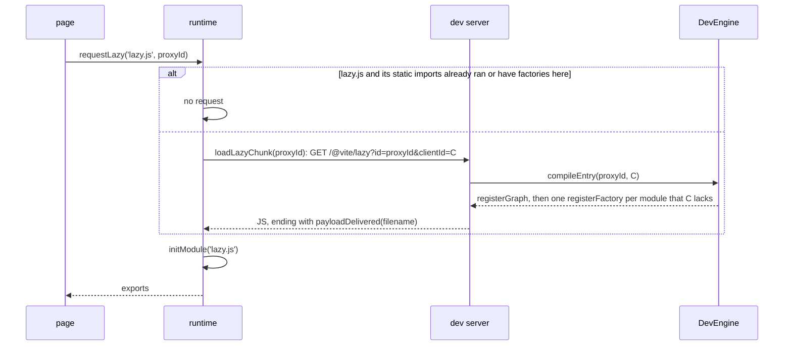
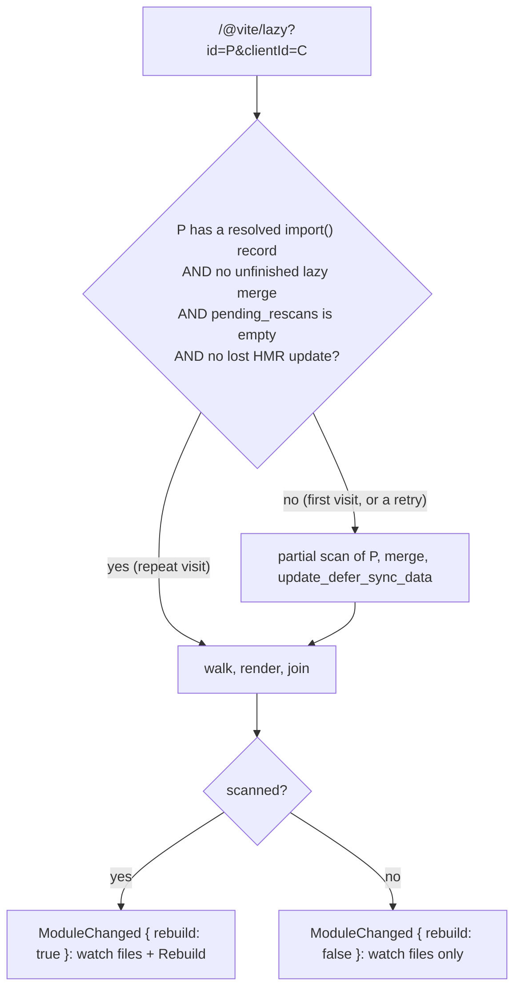

# Lazy Compilation — Design

> The implementation — data lifecycle, module-ID handling, end-to-end flow, and lessons learned: see [implementation.md](./implementation.md).

## Key Notes (TL;DR)

1. **Transparent UX** - `import('./module')` just works; the finalizer rewrites the import into a `requestLazy` call
2. **Dynamic imports only** - static imports always compiled immediately. Boundary creation is module-type-blind (see Scope)
3. **`requestLazy` entry point** - a lazy `import()` compiles to `__rolldown_runtime__.requestLazy(realStableId, proxyId)`; the runtime loads the chunk once through `loadLazyChunk`, then runs the module through the ordinary `initModule` gate
4. **Compilation granularity** - lazy module + the sync deps whose current copy the requesting client does not already hold; nested `import()` become new lazy boundaries
5. **Dev server returns JS directly** - `/@vite/lazy` returns the compiled code as a single JS string; the browser loads it as an ES module (only inline sourcemaps survive — see implementation.md)
6. **Module IDs** - runtime module-map lookups use **stable IDs** (cwd-relative); absolute paths appear only in the proxy id that `requestLazy` passes to `loadLazyChunk` (sent as the `/@vite/lazy?id=` param) and the fetched template's `import($MODULE_ID)`
7. **Proxy module states** - a proxy is a server-side graph node, never fetched as a chunk. Two states: **not fetched** (empty body, keeps the real module out of the build) and **fetched** (imports the real module, rooting the partial scan)
8. **Build output refresh** - a lazy compile that scans queues a background rebuild, so the build output matches the graph again; the rebuild is silent to connected clients. A repeat visit of a fetched route skips both the scan and the rebuild (see [Repeat Visits](#6-repeat-visits))
9. **Dedup** - the server skips modules whose current copy the client already holds (its ship map + boot-evaluated map, `HmrStage::compile_lazy_entry`); in the browser `initModule` runs a factory only when the module is not yet in the module cache — a shared module never executes twice
10. **Error handling** - unknown module ids are rejected (security gate, #9969); init errors in lazy modules reject the consumer's `await import()` catchably (#9981)
11. **ClientId** - browser-generated id per tab (Vite's `bundledDevClient.ts`); selects the per-client `ClientSession` (`crates/rolldown_dev/src/types/client_session.rs`) whose ship map and boot-evaluated map size the lazy chunk
12. **After boot, only factories** - a page gets scope-hoisted code only at boot; every lazy route reaches it as factories, even a route the server compiled before (see [After Boot, Only Factories](#5-after-boot-only-factories))

## What is Lazy Compilation?

Lazy compilation is a **development optimization** that defers compilation of dynamically imported modules until they are actually requested at runtime.

### Goals

1. **Faster cold starts** - Only compile entry points and their synchronous dependencies on startup
2. **On-demand compilation** - Code behind `import()` is compiled just-in-time when the browser executes it
3. **Transparent to users** - No code changes required; `import('./foo')` should just work

## Enabling

Lazy compilation is opt-in, nested inside dev mode:

```js
export default {
  experimental: {
    devMode: { lazy: true },
  },
};
```

- `devMode` alone enables the dev/HMR machinery (`HmrPlugin`); `lazy: true` additionally prepends `LazyCompilationPlugin` before user plugins (`crates/rolldown/src/utils/apply_inner_plugins.rs`).
- The plugin's `context()` exposes the shared `lazy_entries` / `fetched_entries` sets as a `LazyCompilationContext`, which is handed to the `DevEngine` so it can call `mark_as_fetched` before each lazy compile.
- rolldown-vite's bundled dev mode enables `lazy: true` by default.

## Scope

- **Dynamic imports only** (`import()`) - static imports are always compiled
- **Standalone feature** - Reuses the HMR runtime/rendering path for module output. The `/@vite/lazy` request itself emits no HMR update — but once fetched, the lazy module is an ordinary watched graph module, and later edits to it flow through the normal per-client HMR pipeline (see implementation.md "Editing a fetched lazy module")
- **Module-type-blind boundary** - `resolve_id` proxies _every_ dynamic import, with no extension or module-type filter, so the real target is not loaded until the first `/@vite/lazy` request. Everything in the compiled unit must render as an ECMAScript AST:
  - **CSS** - unsupported in rolldown (removed, #4271); lazy compilation _defers_ the hard error from server startup to the first `/lazy` request (HTTP 500, catchable rejection at the consumer's `await import()`)
  - **JSON / text / base64 / dataurl** - currently broken inside lazy chunks: their exports are synthesized at link time, which the lazy render path skips, so they register empty exports until a rebuild + page refresh (see implementation.md Known Limitations)
  - **Binary assets** - work only when a plugin converts them to JS in its `load` hook (e.g. the dev server's Vite-style asset plugin); emitted bytes are delivered via `onAdditionalAssets` (#9815)
- The compiled unit includes all static deps of the lazy module, and `new URL(...)` references count as static

## Compilation Granularity

When a lazy module is requested:

- Compile **that module + its synchronous dependencies** — minus any module whose current copy the requesting client already holds: its factory was shipped (the ship map `shipped[C]`) or the entry chunk ran it at top level (the boot-evaluated map). Both records live in the client's `ClientSession` (`crates/rolldown_dev/src/types/client_session.rs`); the HMR model behind them is in [hmr/design.md](../hmr/design.md)
- Nested dynamic imports (`import()` within the lazy module) are **not** compiled - they become their own lazy boundaries
- This creates a natural "lazy boundary" at each dynamic import

```
Entry
├── sync-dep-1 (compiled immediately)
├── sync-dep-2 (compiled immediately)
└── import('./lazy-a')  ← lazy boundary
    ├── sync-dep-3 (compiled when lazy-a is requested)
    ├── sync-dep-4 (compiled when lazy-a is requested)
    └── import('./lazy-b')  ← another lazy boundary (NOT compiled yet)
```

Inside a rendered lazy chunk (or HMR patch), a nested `import()` of another lazy proxy is rewritten by the HMR finalizer into the same `requestLazy` call the full build emits (see "The `requestLazy` Entry Point" below), so a nested boundary also costs one request (see implementation.md "Lazy chunk rendering").

## Key Design Decisions

### 1. Transparent User Experience

Users should not need to change their code. `import('./module')` just works.

### 2. The `requestLazy` Entry Point

A lazy `import()` is rewritten by the finalizer into a single runtime call:

```js
// User code (unchanged)
const mod = await import('./lazy.js');

// Emitted
const mod = await __rolldown_runtime__.requestLazy('lazy.js', '/abs/path/lazy.js?rolldown-lazy=1');
```

Both codegen paths emit this same shape (`create_request_lazy_call`) — the full build from `try_rewrite_import_expression`, HMR patches from `rewrite_dynamic_import` — so a lazy boundary never becomes a chunk the browser fetches, and a cold lazy route costs one request.



A route whose factories the page does not hold always takes the request path, also after a reload and also when the server compiled the route before. What the server skips on such a repeat visit is in [Repeat Visits](#6-repeat-visits).

The first argument is the **real** module's stable id, known at compile time. `requestLazy` memoizes the promise under that id, which is the dedup point: one request no matter how many places import the module. `removeModuleCache` drops the memo, so a module edited after being lazily loaded is re-run rather than served stale.

The second argument is the boundary's own id (absolute path + `?rolldown-lazy=1`). `requestLazy` passes it to `loadLazyChunk`, which makes the request (see [Dev Server Integration](#4-dev-server-integration)).

Nothing is registered under the proxy id in the client. A cache entry with no factory behind it reads as "executed" to the HMR boundary walk, which would turn a patch arriving mid-load into a full page reload.

The client graph has no proxy node either: `registerGraph` links the importer straight to the real module. A proxy node would be the real module's only importer, and since it never runs, the boundary walk would stop at it and drop the update. The server walk, which decides what a patch carries, steps over the proxy in the same way, so the two walks reach the same importers. The client rows link the importer to the real module whether or not the proxy was fetched. An unfetched proxy is the stub with no `import()`, so the server walk finds the proxy by the real module's id, not by an import record.

**CommonJS interop happens in the runtime, not at the call site.** A production build rewrites `import()` of a CommonJS module into `__toESM(require_x(), isNodeMode)`, so the importer sees `default` = `module.exports`. The lazy call site cannot do the same: the importer is compiled while the importee is still a stub, so its exports kind is unknown (vitejs/vite#23558). The split is:

- The call site passes only what the importer knows: `is_node_mode` (`should_consider_node_esm_spec_for_dynamic_import`, the same choice a production build makes) as a third argument `1`.
- A CommonJS module registers itself with `registerModule(id, module, 1)`. This is the same statement for the initial bundle, HMR patches and lazy chunks (`create_register_module_stmt`).
- `requestLazy` memoizes the module run under the real id, then hands each caller `__toESM(exports, isNodeMode)` when the module registered as CommonJS, and the namespace as is otherwise. Interop is applied per caller because the mode is per importer.

Pinned by the cjs-interop browser spec (fetched and resident module) and the CommonJS tests in `dev-lazy-compile.test.ts`.

### 3. Proxy Module States

A proxy module has two states that determine what content the `LazyCompilationPlugin` returns:

#### Not Fetched (Initial State)

Returns the **stub template** (`proxy-module-template.js`), an empty module:

```js
export {};
```

The body is never executed — every `import()` of this id was rewritten to `requestLazy`. The module exists only so the graph has a node under this id, and an empty body is what keeps the real module out of the initial build.

#### Fetched (After First Request)

Returns the **fetched template** (`proxy-module-template-fetched.js`), which imports the real module:

```js
import($MODULE_ID);
```

This body is not executed either. Its `import($MODULE_ID)` matters at **scan** time only: it is the edge `compile_lazy_entry` follows to pull the real module and its dependencies into the partial build, and it keeps a fetched route in later builds. `$MODULE_ID` is the absolute path, used for resolution only.

The state transition is managed by `LazyCompilationContext.mark_as_fetched()`.

### 4. Dev Server Integration

The dev server owns the lazy endpoint URL. The client loads a lazy chunk through `DevRuntime#loadLazyChunk(proxyModuleId)` (`runtime-extra-dev-common.js`):

- The default imports `/@vite/lazy?id=...&clientId=...`.
- A server that serves the endpoint at another URL overrides the method in its `DevRuntime` subclass.
- Emitted code carries ids only. It never contains the URL, the `clientId`, or `encodeURIComponent` (a user binding of that name in the importer's scope cannot break the request).

The dev server handles these requests:

1. Receive request with the **proxy module ID** (absolute path with `?rolldown-lazy=1`) and the client's UUID
2. Call `DevEngine.compileEntry(moduleId, clientId)` (TS) / `DevEngine::compile_lazy_entry` (Rust)
3. `DevEngine::compile_lazy_entry` copies that client's ship map and boot-evaluated map out of its `ClientSession` and marks the proxy as fetched
4. **Security gate**: the id is only a lookup key into the build cache — an id not already in the module graph is rejected with `Lazy entry module not found in cache` (never resolved from the filesystem, so a malicious request cannot bundle arbitrary files; analogous to Vite's `server.fs.strict`, pinned by test, #9969)
5. Partial scan from the proxy module - plugin returns the fetched template, whose `import($MODULE_ID)` triggers compilation of the actual module. A repeat visit skips this scan (see [Repeat Visits](#6-repeat-visits)). The chunk carries `registerFactory` calls only; `requestLazy` runs the module once the chunk has evaluated
6. Assets emitted during the compile are delivered via the `onAdditionalAssets` callback **before** the code is returned, so they are servable when the chunk executes (#9815)
7. **Return compiled JS directly** (`Content-Type: application/javascript`) - the browser loads it as an ES module; compile failures answer HTTP 500. Vite appends a `__rolldown_runtime__.payloadDelivered(filename)` line to the chunk (`payloadDeliveredAck` in `bundledDev.ts`); when the client runs it, `DevEngine::notify_payload_delivered` records the chunk's modules in that client's ship map
8. **Notify coordinator** - the coordinator watches the files the compile loaded. When the compile scanned, it also queues a background rebuild, so the build output matches the graph again. No page loads the route from that output: every lazy `import()` calls `requestLazy`

### 5. After Boot, Only Factories

A module can reach the page in two shapes. They stop a second run in different ways, and neither knows about the other:

| Shape                                                | When the code runs              | What stops a second run                  |
| ---------------------------------------------------- | ------------------------------- | ---------------------------------------- |
| Scope-hoisted chunk (full build)                     | as soon as the file loads       | the browser, by file URL                 |
| Factory (`registerFactory`, lazy chunk or HMR patch) | when `initModule(id)` is called | the runtime, by module id (module cache) |

When one page mixes the shapes, a module can pass both checks and run twice. So:

> **A page gets scope-hoisted code only at boot. Everything that arrives after boot is a factory.**

Lazy mode follows this. The full build emits `requestLazy` for every lazy `import()`, fetched or not, so a route never loads from the build output. Example: `route-a.js` and `route-b.js` both import `store.js`. The user visits A, reloads, then visits B and then A. B arrives as factories and runs `store.js`. A also arrives as factories, and `initModule` returns the `store.js` that already ran. Had A come back as a built chunk, `store.js` would run a second time and A would get its own store. Pinned by the shared-module spec.

Rejected options for making a repeat visit cheaper:

- **Redirect `/@vite/lazy` to a built chunk** (vitejs/vite#23502). It brings built chunks back after boot, so it mixes the shapes. It also needs server-side guesses: the build generation is known at WebSocket connect, not at page load; the redirect must stop after the first payload; and Vite would copy state that `DevEngine` already has.
- **A loader made by the build** (`requestLazy(id, proxyId, () => import('./x-HASH.js'))`). It mixes the shapes too, and needs page-side rules (no payload and no push since load) plus checks for timing cases.

### 6. Repeat Visits

A page that reloads loses its factories, so a visited route costs one `/@vite/lazy` request again. That compile does not need to scan:



The rule, in `HmrStage::compile_lazy_entry`:

1. **The proxy is in fetched form.** Only the fetched template has an `import()`, so a resolved `import()` record on the proxy means the route's closure is already in the graph. This reads the graph, not `fetched_entries`: `mark_as_fetched` runs before every compile, so a retry after a failed first compile would look like a repeat visit. A failed scan is reverted and never reaches `merge`, so after a failed scan the proxy stays a stub, and the next compile scans again.
2. **No unfinished lazy merge.** A compile can fail after its `merge`, in `update_defer_sync_data` or in the sourcemap step (a user callback such as `sourcemapIgnoreList` can throw). The route is then in the graph, but no `ModuleChanged` was sent, so no `Rebuild` was queued. The compile sets `ScanStageCache::unfinished_lazy_merge` right after its `merge`, and only a compile that returns clears it. While it is set, the next compile scans again and queues the `Rebuild`. A full scan replaces the cache, so it clears the flag too.
3. **`pending_rescans` is empty.** Files that failed an earlier scan are retried only by a scan.
4. **No lost HMR update.** A lost update needs the `Rebuild` that follows a scan. It becomes a full build that reloads every client.

Why skipping is safe: with no scan, `merge` does not run and the graph does not change, so a `Rebuild` would write the output that already exists. A scan of the proxy would not reload the real module either, because a partial scan invalidates only the ids it lists.

A deleted route file goes through the HMR stage. The delete event rescans the proxy (an importer of the deleted module), and that scan fails to resolve the file. The failed scan queues the proxy in `pending_rescans`, so the next compile scans and reports the same error, as a scan-first compile would.

The compile returns `scanned` in `HmrLazyChunkOutput`, and logs it with the payload size (`modules`) and per-phase timings (`tracing` target `hmr`, message `compile_lazy_entry: done`).

**Rejected option: a factory cache.** A repeat visit skips the scan, but it still renders every module of the route. A cache of rendered factories (one entry per module, checked against the module's stamp, dropped by `merge` when a render input changes) would let a repeat visit join the cached factories instead of rendering them. Measured on a route of about 1500 modules:

- A repeat click goes from about 10 ms to about 2.8 ms. Skipping the scan alone already brings a repeat click from about 60 ms to about 10 ms.
- The cache holds about 12 MB per 1500 modules with sourcemaps on, and about 3 MB without. Each entry keeps the code and the sourcemap, and the sourcemap's `sourcesContent` is a second copy of the module's text. It grows with every module rendered into a lazy chunk until the next full scan.
- Only lazy payloads after the first one read it. The first visit of a route, HMR patches, and the initial build gain nothing.

It was rejected because about 7 ms per repeat click does not pay for that memory. It also adds rules that must stay correct: `merge` must drop every entry whose render read a changed module, the module itself or an importee reached through its import records.

## Unresolved Questions

- **Lazy barrels get no new stamp.** A barrel record that a later route resolves changes the barrel's factory without a new stamp. Recorded with an example in [hmr/design.md](../hmr/design.md#unresolved-questions); not fixed.

## Related

- [implementation.md](./implementation.md) — the lazy-compilation implementation
- [hmr/design.md](../hmr/design.md) — the client-side HMR model; lazy chunk sizing reads its ship map and boot-evaluated map
