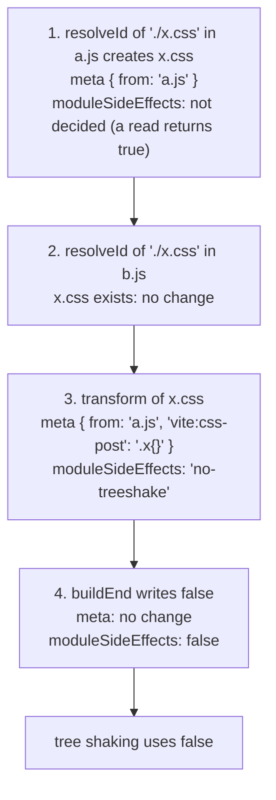

# Module meta and `moduleSideEffects` — Design

## Summary

A plugin can set two values on a module: its `meta` and its
`moduleSideEffects` value. A hook sets them, and a later hook or tree
shaking reads them. This document defines where the values come from, how
hooks change them, what a read returns, and how long they live. The rules
follow Rollup, with a few differences that are listed at the end.

For the machinery, see the JavaScript side cache section of
[cache/implementation.md](../cache/implementation.md).

## Goals and decisions

- **Follow Rollup.** Plugins written for Rollup get the same values. Only
  the resolution that creates a module sets its first values. Other
  resolutions, `this.resolve` and the options of `this.load` for a module
  that exists do not change the module.
- **Keep each value in one place.** `moduleSideEffects` lives only in Rust,
  where tree shaking reads it. A hook result brings its value to Rust with
  the result itself. `meta` lives only in JavaScript, because plugins change
  it in place, as in Rollup.
- **A read returns the input of tree shaking.** When no hook decided
  `moduleSideEffects`, a read returns a default value (see
  [Reading `moduleSideEffects`](#reading-modulesideeffects)). It never
  returns "not decided", and it does not return the result of
  Rolldown's own check of the code. So a read from `load` on already gives
  a value.
- **A write of `null` clears the value.** The value is then "not decided",
  as if no hook had decided it. A value that a hook returned before the
  write does not come back.
- **`this.resolve` returns the value of its own resolution.** It returns the
  `moduleSideEffects` that the hooks of this resolution returned. When none
  did, it returns what a read of `getModuleInfo` returns for a value that is
  not decided (see [Reading `moduleSideEffects`](#reading-modulesideeffects)).
  So a plugin that returns a `this.resolve` result as its own `resolveId` result
  passes on the value that Rolldown uses, also the `package.json` value.
- **The persistent scan cache depends on these rules.** It saves what hooks
  return, and applies the saved values by the same rules. See
  [0003 Module meta and `moduleSideEffects`](https://github.com/rolldown/cache/blob/main/design-docs/0003-module-meta-and-module-side-effects.md)
  in rolldown/cache.

## Example

The sections below use one example. The entry `main.js` imports `./a.js`
and `./b.js`, and both of them import `./x.css`:

```js
// main.js
import './a.js';
import './b.js';

// a.js and b.js
import './x.css';
```

In this example, the module task of `a.js` ends first. Three plugins set
values for `x.css`:

```js
// A plugin that resolves './x.css' and tells which importer asked first.
resolveId(source, importer) {
  if (source === './x.css') {
    return { id: '/src/x.css', meta: { from: path.basename(importer) } }
  }
},

// vite:css-post, as in vitejs/vite#24085: it keeps the CSS for renderChunk.
transform(code, id) {
  if (id === '/src/x.css') {
    return { code: '', moduleSideEffects: 'no-treeshake', meta: { 'vite:css-post': '.x{}' } }
  }
},

// Another plugin that writes through module info.
buildEnd() {
  this.getModuleInfo('/src/x.css').moduleSideEffects = false
},
```

The values of `x.css` change in four steps:



## Creation

Rolldown creates a module when a resolution of its id reaches the module
loader for the first time in a build. A resolution reaches the module loader
at one of these times:

- the `resolveId` call of an entry: at the start of the build, after the
  `resolveId` calls of all entries return and before any import;
- the `resolveId` call of a chunk that a hook emits: when the call returns;
- the `resolveId` or `resolveDynamicImport` call of an import: when the
  module task of the importing module ends, together with the other imports
  of that module;
- a `this.load` call for an id that has no module yet: when the call is
  made. Its `meta` and `moduleSideEffects` options are the values of this
  resolution.

The resolution that creates the module is its
creating resolution. It sets two values:

- `meta`: a copy of the `meta` object that the resolution returned. The copy
  is a new object with the same keys. The values under the keys are not
  copied.
- `moduleSideEffects`: the value that the resolution returned, or "not
  decided" when it returned none.

For example, a `resolveId` hook returns `meta: returned`:

```js
const shared = { list: [] };
const returned = { from: 'a.js', shared };

getModuleInfo('/src/x.css').meta === returned; // false: a new object
getModuleInfo('/src/x.css').meta.shared === shared; // true: the same value
```

Later resolutions of the same id, `this.resolve`, and the options of a
`this.load` call for a module that exists do not change the module. A plugin
should return the same values for the same id.

In the example, the module task of `a.js` ends first, so its resolution of
`./x.css` reaches the module loader first. It creates `x.css` with
`{ from: 'a.js' }` (step 1). The resolution from `b.js` comes later, so
`{ from: 'b.js' }` is not used (step 2). This holds also when the
`resolveId` call in `b.js` returns before the one in `a.js`.

## Hook results

After the module is created, its own `load` and `transform` hooks can return
the two values:

- `load`: Rolldown calls the `load` hooks of the plugins in order, and uses
  the first one that returns a result.
- `transform`: Rolldown calls every `transform` hook in order. Each one gets
  the code from the hook before it.

Each of these results that is an object changes the values of the module:

- `moduleSideEffects`: a value that is not `null` or `undefined` replaces the
  current value. `null`, `undefined` or no key keeps the current value.
- `meta`: Rolldown adds each key of the returned `meta` to the `meta` of the
  module, as `Object.assign` does. A key replaces the whole value of the same
  key. Values are not merged deeper. The `meta` of the module stays the same
  object.

A result that is a string has no `meta` and no `moduleSideEffects`, so it
changes nothing.

For example, the `meta` of a module is `{ from: 'a.js', opts: { x: 1 } }`, and
a `transform` hook returns `meta: { opts: { y: 2 } }`. The `meta` becomes
`{ from: 'a.js', opts: { y: 2 } }`. The key `x` is gone, because `opts` is
replaced as a whole.

In the example, the `transform` hook of `vite:css-post` returns
`'no-treeshake'`, which replaces "not decided". It adds the key
`'vite:css-post'` next to `from` (step 3).

## Writes

Any hook can change the values of any module through
`this.getModuleInfo(id)`.

### `meta`

`getModuleInfo(id).meta` is the `meta` object of the module
itself, so a hook changes the `meta` by changing its keys. Every later reader
sees the change. A later `load` or `transform` result of the module merges
into the same object, as [Hook results](#hook-results) says, so the written
keys stay. For example, a `load` hook writes a key for `x.css` and returns
nothing, and then `transform` returns `meta`:

```js
// a load hook, called for x.css
this.getModuleInfo('/src/x.css').meta.checked = true;
// meta of x.css: { from: 'a.js', checked: true }

// the transform hook of vite:css-post returns meta: { 'vite:css-post': '.x{}' }
// meta of x.css: { from: 'a.js', checked: true, 'vite:css-post': '.x{}' }
```

Assigning a new object to the `meta` property does not change the module.
Each `getModuleInfo` call returns a new info object, and its `meta` property
points to the `meta` object of the module. An assignment only makes the
`meta` property of that one info object point to another object:

```js
const info = this.getModuleInfo('/src/x.css');
info.meta = { checked: false };
info.meta.checked; // false
this.getModuleInfo('/src/x.css').meta.checked; // true: the module did not change
```

### `moduleSideEffects`

A hook can assign `true`, `false`, `'no-treeshake'`,
`null` or `undefined`. Another value throws. `true`, `false` or
`'no-treeshake'` replaces the current value. The value stays until a later
write, or until a later `load` or `transform` hook of the module returns a
value that is not `null` or `undefined`. `null` or `undefined` clears the
value, and Rolldown treats the module as if no hook had decided it. It does
not go back to a value that a hook returned before the write.
[Reading `moduleSideEffects`](#reading-modulesideeffects) says what Rolldown uses then.

Tree shaking uses the writes that are made up to the end of `buildEnd`.
Rolldown ignores a write in a later hook, such as `renderChunk`, or in a
`codeSplitting.groups` function: a later read still returns the value from
before the write, and the next build does not use it either. Rolldown warns
about the first such write in a build
(`MODULE_SIDE_EFFECTS_WRITE_AFTER_BUILD_END`).

In the example, `buildEnd` writes `false`, and tree shaking uses `false`
(step 4). If it wrote `null`, the value would be "not decided" again.
Rolldown would not go back to the `'no-treeshake'` from `transform`, and
[Reading `moduleSideEffects`](#reading-modulesideeffects) would give `true`.

## Reading `moduleSideEffects`

A hook can read `getModuleInfo(id).moduleSideEffects` from the time the
module is created, so the `load` hook of the module can already read it. It
returns the value that tree shaking starts from.

When the module is created, its value is the one that the creating
resolution returned, as [Creation](#creation) says. After that, each hook
result and each write can change it, as [Hook results](#hook-results) and
[Writes](#writes) say. The value is "not decided" when none of them gave a
value, or when a write of `null` or `undefined` cleared it and nothing gave
a value after that.

`getModuleInfo(id).moduleSideEffects` never returns "not decided". When the
value is "not decided", a read returns a default value from the items
below instead. A read does not change the value, and it does not check the
code of the module.

A read first checks whether the value is decided. If it is, the read
returns that value. If it is "not decided", Rolldown starts at item 1. Each
item says what the read returns, or which item comes next.

1. The `treeshake.moduleSideEffects` option:
   - `true`, which is the default: go to item 2.
   - `false`: the read returns `false`.
   - An array of ids: the read returns `true` for an id in the array, and
     `false` for any other id.
   - A list of rules: the read returns the value of the first rule that
     matches the id. When no rule matches, go to item 2.
   - A function: the read returns `true` or `false` when the function returns
     it. When the function returns `null` or `undefined`, go to item 2.
2. The kind of module:
   - An external Node.js built-in, such as `node:fs`: the read returns
     `false`, because tree shaking treats it as having no side effects by a
     Rolldown default.
   - Any other external module: the read returns `true`.
   - A normal module: the `sideEffects` field of its `package.json`.
     - The field gives `true` or `false` for the path of the module: the
       read returns that value.
     - The field says nothing about the path, or Rolldown does not know the
       `package.json` of the module: go to item 3. Rolldown knows it when
       Rolldown's resolver found it, or when a `resolveId` hook returned
       `packageJsonPath`.
3. The read returns `true`.

The value is the input of tree shaking, not its result. For example, `true`
from item 3 means that tree shaking checks the statements of the module.

With `treeshake: false`, Rolldown does not check items 1 and 2, and a read
of a value that is "not decided" returns `true`. Although a read returns
`true`, tree shaking is off, and Rolldown keeps every module.

In the example, the `resolveId` hook in step 1 returns no
`moduleSideEffects`, so `x.css` starts as "not decided". A hook that reads
`getModuleInfo('/src/x.css').moduleSideEffects` between step 1 and step 3
gets `true`. Vite does not set the `treeshake.moduleSideEffects` option, so
the option has the default `true` and gives nothing. Rolldown knows no
`package.json` for `x.css`, because the plugin returned the id without
`packageJsonPath`. After step 3 a read returns `'no-treeshake'`, and after
step 4 it returns `false`.

## Lifetime

What happens to the values in the next build depends on the kind of build.

**A full build** drops the values of every module before `buildStart`. Each
module is then created again, as [Creation](#creation) says. These builds
are full builds:

- a `rolldown()` build;
- each rebuild in watch mode, unless `experimental.incrementalBuild` is on;
- the first build of a dev engine.

**A partial scan** runs the hooks again only for the modules that changed.
It is used for an HMR update, and for a rebuild with
`experimental.incrementalBuild`.

Before the hooks run, each changed module goes back to the values that its
creating resolution gave. Rolldown kept this resolution when it created the
module, and fetches the module again from it. It does not call `resolveId`
for the changed module: a `resolveId` hook gets a specifier, and the id of
a module, such as the id of a virtual module, can resolve to another
module. So:

- `meta` becomes a new copy of the `meta` of the creating resolution. Keys
  that hooks wrote, and keys that the last `load` and `transform` results
  added, are gone. The copy is shallow, as in Rollup: a hook that changed a
  nested object of `meta` in place also changed the copy that Rolldown
  keeps, so that change stays.
- `moduleSideEffects` becomes the value of the creating resolution again,
  and a value that a hook wrote is dropped. Without a value from the
  resolution, it falls back to `package.json` as usual. An incremental
  rebuild reads `package.json` again when it fetches the module, so
  `buildStart` still sees the fallback from the last fetch.

For an incremental rebuild, this happens before `buildStart`, so
`getModuleInfo` in `buildStart` shows these values. It happens again
after `buildStart`, so a change that `buildStart` made to a changed module
is also gone.

Then the `load` and `transform` hooks of the module run again and apply
their results, as [Hook results](#hook-results) says. The modules that did
not change keep their values, also the values that writes gave them.

**A lazy compile** creates the real module of a lazily imported module. It
resolves the original import again, and that resolution creates the module,
as [Creation](#creation) says.

In the example, `x.css` changes during dev. An HMR update starts a partial
scan for `x.css` only:

1. `x.css` goes back to the values of the resolution from `a.js`. Its `meta`
   becomes `{ from: 'a.js' }`, and its `moduleSideEffects` becomes "not
   decided". The old CSS under `'vite:css-post'`, and the `false` that
   `buildEnd` wrote, are gone.
2. The `transform` hook of `vite:css-post` runs again. It adds the new CSS
   under `'vite:css-post'`, and sets `moduleSideEffects` to `'no-treeshake'`.

`a.js` and `b.js` did not change. Their hooks do not run again, and their
values stay as they are.

## Differences from Rollup

The rules above match Rollup, except in these points.

**Which importer creates the module.** In Rolldown, the importer whose
module task ends first creates the module. In Rollup, the resolution that
ends first creates it. In the example, if the `resolveId` call in `b.js`
returns before the one in `a.js`, Rollup creates `x.css` with
`{ from: 'b.js' }`. Rolldown still creates it with `{ from: 'a.js' }`,
because the module task of `a.js` ends first.

**The option and `package.json`.** When both the
`treeshake.moduleSideEffects` option and `package.json` give a value for a
module, Rolldown uses the option. Rollup's core does not read
`package.json`. `@rollup/plugin-node-resolve` returns the `package.json`
value from its `resolveId` hook, so in Rollup it counts as a hook value and
comes before the option.

**A Node.js built-in.** For an external Node.js built-in with no hook value,
such as `node:fs`, a read returns `false` in Rolldown, because tree shaking
treats it as having no side effects by a Rolldown default. Rollup returns
`true`, and keeps `import 'node:fs'`.

**`package.json` in a read.** In Rolldown, a read of
`getModuleInfo(id).moduleSideEffects` can return the value of the
`package.json` `sideEffects` field, as
[Reading `moduleSideEffects`](#reading-modulesideeffects) says. Rollup's
core does not read `package.json`. For a module whose `package.json` has
`"sideEffects": false`, a read returns `false` in Rolldown and `true` in
Rollup.

**A write of `null`.** In Rolldown, a write of `null` clears the value, and
tree shaking uses the value from items 1 to 3. Rollup stores `null`, a read
returns `null`, and tree shaking treats it as `false`. In the example, if
`buildEnd` wrote `null`, a read would return `true` in Rolldown and `null`
in Rollup.

**When a write reaches tree shaking.** In Rolldown, tree shaking uses the
writes made up to the end of `buildEnd`, both `true` and `false`. Rolldown
links the modules before the output hooks run, so it ignores later writes,
and a later read does not show them. In Rollup, a `false` written as late as
`renderStart` still removes code. But a `true` written in `buildEnd` or later
does not bring removed code back, and a later read shows any written value.
In the example, the `false` in `buildEnd` reaches tree shaking in both.

## Related

- [cache/implementation.md](../cache/implementation.md) — the JavaScript side
  cache: module options, resolution receipts, and the reset of a partial
  scan
- [lazy-compilation/implementation.md](../lazy-compilation/implementation.md)
  — how a lazy compile resolves the original import again
- [rolldown/cache 0003](https://github.com/rolldown/cache/blob/main/design-docs/0003-module-meta-and-module-side-effects.md)
  — how the persistent scan cache saves and reuses these values
