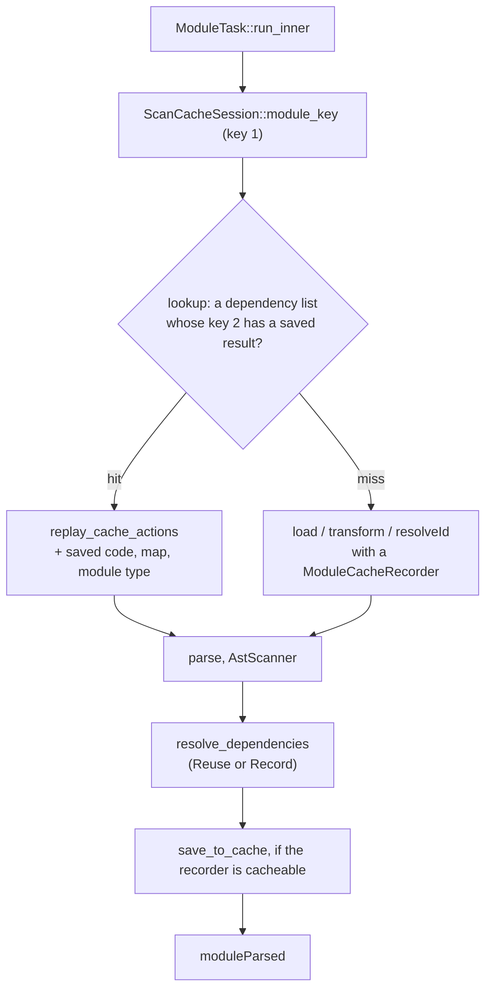

# Persistent scan cache — Implementation

> The design, its rules and its open questions live in the
> [rolldown/cache](https://github.com/rolldown/cache) repository:
> [0002 Persistent scan cache](https://github.com/rolldown/cache/blob/main/design-docs/0002-persistent-scan-cache.md)
> and [0001 Restart validation](https://github.com/rolldown/cache/blob/main/design-docs/0001-restart-validation.md).

## Summary

With `experimental.cache`, each module task saves the result of its `load`,
`transform` and `resolveId` hooks to disk. After a restart, a full scan finds
the saved result of a module by two keys and reuses it: the hooks do not run,
parsing and `moduleParsed` run again. The in-memory `ScanStageCache` and
incremental builds do not change. An incremental build and HMR do not read
saved results, because the scan results in memory are faster; they only save
new ones. A lazy compile (`HmrStage::compile_lazy_entry`) fetches modules that
are not in memory yet, so it reads saved results like a full scan.

## Components

| Concept                              | Code                                                                                                                          |
| ------------------------------------ | ----------------------------------------------------------------------------------------------------------------------------- |
| Option `experimental.cache`          | `crates/rolldown_common/src/inner_bundler_options/types/cache_options.rs`                                                     |
| Options hash                         | `options_cache_hash` in `crates/rolldown_common/src/inner_bundler_options/cache_hash.rs`, computed in `prepare_build_context` |
| Per-hook `cache` flag                | `PluginHookMeta::cache` in `crates/rolldown_plugin/src/types/plugin_hook_meta.rs`                                             |
| Which plugins are cacheable per hook | `CacheableHooks` in `crates/rolldown_plugin/src/plugin_driver/mod.rs`                                                         |
| Counting the hook calls of a task    | `PluginDriver::check_cacheable_call` in `crates/rolldown_plugin/src/plugin_driver/build_hooks.rs`                             |
| Recording side effects               | `ModuleCacheRecorder` in `crates/rolldown_plugin/src/types/module_cache_recorder.rs`                                          |
| Replaying side effects               | `PluginDriver::replay_cache_actions` in `crates/rolldown_plugin/src/plugin_driver/mod.rs`                                     |
| Keys, lookup, save, flush            | `PersistentScanCache`, `ScanCacheSession` in `crates/rolldown/src/persistent_cache/mod.rs`                                    |
| Saved result format                  | `SavedResult` in `crates/rolldown/src/persistent_cache/saved_result.rs`                                                       |
| Files on disk                        | `CacheStore` in `crates/rolldown_cache_store`                                                                                 |

## Lifetimes

- `PersistentScanCache` lives in `BundleFactory`. It holds the open
  `CacheStore`. Watch mode and the dev engine keep it across rebuilds.
  `ClassicBundler` creates a factory for each build, so it opens the store each
  time.
- `ScanCacheSession` lives for one scan. `ScanStage::scan` and the two HMR
  loaders in `hmr_stage.rs` create it with `start_scan`. It holds key 1 without
  the module part, and the state of each file that the scan has read, so each
  file is read once per scan.
- `ModuleCacheRecorder` lives for one module task, and only when the task can
  get a saved result and did not find one.

## Recording

The driver forks the plugin context for each hook call of a recorded task
(`PluginContext::fork_for_call`), so every context method can reach the
recorder: `add_watch_file`, `emit_*`, `associate_module_with_file_ref`, the
log methods and `load`. `LoadPluginContext` and `TransformPluginContext` also
record transform dependencies. A nested `this.resolve` passes the recorder on
through `resolve_id_check_external`.

A JavaScript hook reaches Rust through the same forked context:
`BindingTransformPluginContext::inner` returns it. What Rust cannot see, the
JavaScript side reports with `BindingPluginContext::markNotCacheable` (a
returned `meta`, an assignment to `moduleSideEffects`, `this.load`) and
`BindingPluginContext::recordLog` (a log sent to `onLog`). Rust marks a
JavaScript hook that returns `moduleSideEffects` itself, in `js_plugin.rs`.

A recorded JavaScript log is replayed as a `Log` with only `js_log_json` set.
The `onLog` wrapper on the JavaScript side passes the parsed object on.

## Writing

`save` puts the encoded result into the store's pending data. At the end of a
scan, `start_flush` writes the pending data on a background thread while the
build links and generates. `Bundle::write`, `generate` and `scan` wait for it
before they return, so a one-time build does not exit first. Incremental
builds and HMR do not wait. The next scan or `Bundler::close` waits and
prints a failed write as a warning; `Drop` only waits.

`CacheStore::flush` writes one new segment file. It never copies large
segments: it only merges many small ones, and copies a segment for `maxAge`
only when at least half of its data is expired.

## Invariants

- A saved result is only added, never changed. A changed input gives other
  keys, so old data is not found. `maxAge` and segment merging in
  `CacheStore` are the only removals.
- A saved result is reused as a whole or not at all: if a `package.json` that
  its resolve results name cannot be read, the module runs its hooks.
- When a build dependency changes while a bundler runs, the cache is off for
  that bundler: its options and plugins come from the old build dependency.
- Any data that cannot be read or decoded is "not found". No cache error fails
  a build; a failed write prints a `PERSISTENT_CACHE_WRITE_FAILED` warning.
- With native MagicString and sourcemaps, `PersistentScanCache::new` returns
  `None`: part of the sourcemap chain is added after the module task.
- The runtime module specifier is never saved in resolve results. A saved
  result without a key for an import falls back to resolving it normally.

## Related

- [`../cache/implementation.md`](../cache/implementation.md) — the in-memory caches, including `ScanStageCache`
- [`../options/design.md`](../options/design.md) — how options flow from JavaScript to Rust
