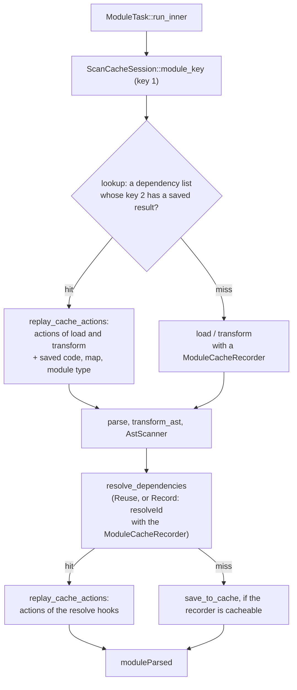
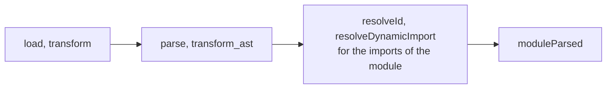
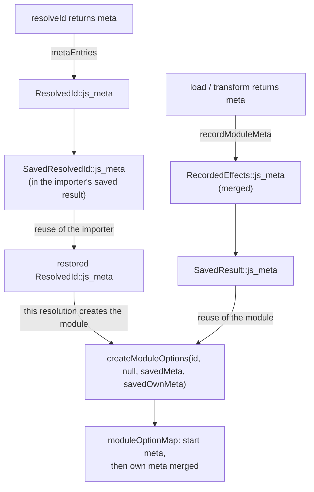
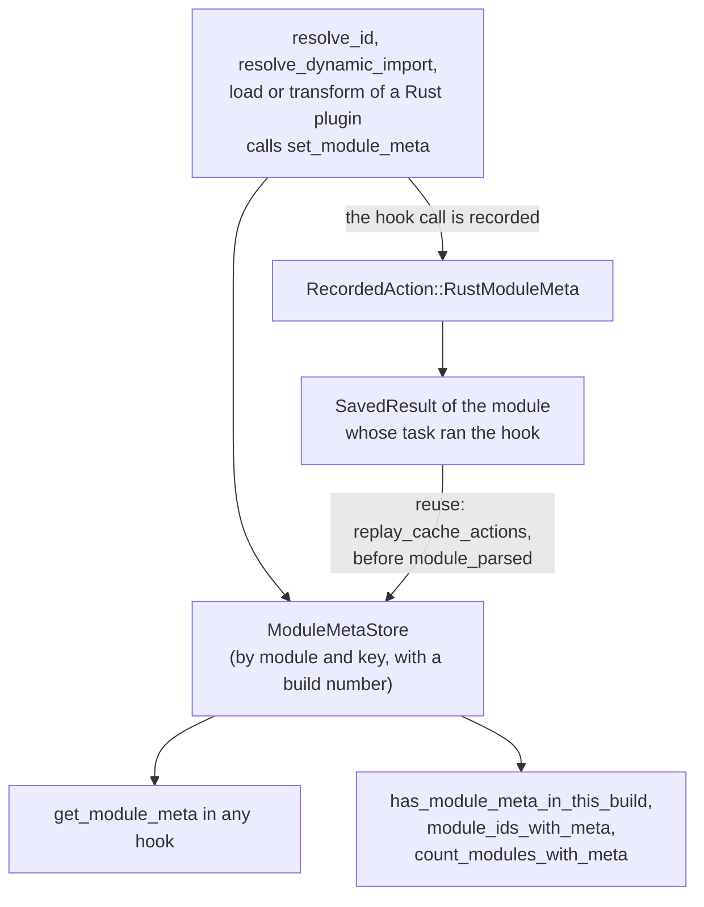

# Persistent scan cache — Implementation

> The design, its rules and its open questions live in the
> [rolldown/cache](https://github.com/rolldown/cache) repository:
> [0002 Persistent scan cache](https://github.com/rolldown/cache/blob/main/design-docs/0002-persistent-scan-cache.md)
> and [0001 Restart validation](https://github.com/rolldown/cache/blob/main/design-docs/0001-restart-validation.md).

## Summary

With `experimental.cache`, each module task saves the result of its `load`,
`transform` and `resolveId` hooks to disk. After a restart, a full scan finds
the saved result of a module by two keys and reuses it: the hooks do not run,
parsing and `moduleParsed` run again. The in-memory `ScanStageCache` and
incremental builds do not change. An incremental build and HMR do not read
saved results, because the scan results in memory are faster; they only save
new ones. A lazy compile (`HmrStage::compile_lazy_entry`) fetches modules that
are not in memory yet, so it reads saved results like a full scan.

## Components

| Concept                              | Code                                                                                                                          |
| ------------------------------------ | ----------------------------------------------------------------------------------------------------------------------------- |
| Option `experimental.cache`          | `crates/rolldown_common/src/inner_bundler_options/types/cache_options.rs`                                                     |
| Options hash                         | `options_cache_hash` in `crates/rolldown_common/src/inner_bundler_options/cache_hash.rs`, computed in `prepare_build_context` |
| Per-hook `cache` flag                | `PluginHookMeta::cache` in `crates/rolldown_plugin/src/types/plugin_hook_meta.rs`                                             |
| Which plugins are cacheable per hook | `CacheableHooks` in `crates/rolldown_plugin/src/plugin_driver/mod.rs`                                                         |
| Counting the hook calls of a task    | `PluginDriver::check_cacheable_call` in `crates/rolldown_plugin/src/plugin_driver/build_hooks.rs`                             |
| Recording side effects               | `ModuleCacheRecorder` in `crates/rolldown_plugin/src/types/module_cache_recorder.rs`                                          |
| Replaying side effects               | `PluginDriver::replay_cache_actions` in `crates/rolldown_plugin/src/plugin_driver/mod.rs`. See [Replaying](#replaying)        |
| Saved `meta` of JavaScript hooks     | `JsModuleMeta` in `crates/rolldown_common/src/types/js_module_meta.rs`                                                        |
| Which `meta` values can be saved     | `toSavableMetaEntries` in `packages/rolldown/src/plugin/savable-meta.ts`                                                      |
| Giving the saved `meta` back to JS   | `createModuleOptions` in `packages/rolldown/src/plugin/plugin-context-data.ts`                                                |
| Module meta of Rust plugins          | `ModuleMetaStore` in `crates/rolldown_plugin/src/types/module_meta_store.rs`                                                  |
| Keys, lookup, save, flush            | `PersistentScanCache`, `ScanCacheSession` in `crates/rolldown/src/persistent_cache/mod.rs`                                    |
| Saved result format                  | `SavedResult` in `crates/rolldown/src/persistent_cache/saved_result.rs`                                                       |
| Files on disk                        | `CacheStore` in `crates/rolldown_cache_store`                                                                                 |

## Lifetimes

- `PersistentScanCache` lives in `BundleFactory`. It holds the open
  `CacheStore`. Watch mode and the dev engine keep it across rebuilds.
  `ClassicBundler` creates a factory for each build, so it opens the store each
  time.
- `ScanCacheSession` lives for one scan. `ScanStage::scan` and the two HMR
  loaders in `hmr_stage.rs` create it with `start_scan`. It holds key 1 without
  the module part, and the state of each file that the scan has read, so each
  file is read once per scan.
- `ModuleCacheRecorder` lives for one module task, and only when the task can
  get a saved result and did not find one.
- `ModuleMetaStore` lives in `BundleFactory`, as long as the bundler. It
  exists also without the cache. It is never cleared. See
  [Module meta of Rust plugins](#module-meta-of-rust-plugins).

## Recording

The driver forks the plugin context for each hook call of a recorded task
(`PluginContext::fork_for_call`), so every context method can reach the
recorder: `add_watch_file`, `emit_*`, `associate_module_with_file_ref`,
`set_module_meta`, the log methods and `load`. `LoadPluginContext` and
`TransformPluginContext` also record transform dependencies. A nested
`this.resolve` passes the recorder on through `resolve_id_check_external`.

A JavaScript hook reaches Rust through the same forked context:
`BindingTransformPluginContext::inner` returns it. What Rust cannot see, the
JavaScript side reports with these methods of `BindingPluginContext`:

| Method             | The JavaScript side calls it for                                                                                                    |
| ------------------ | ----------------------------------------------------------------------------------------------------------------------------------- |
| `markNotCacheable` | `this.markNotCacheable`, `this.load`, a returned `meta` or a log that cannot be saved, a use of `meta` through `this.getModuleInfo` |
| `recordLog`        | A log sent to `onLog`                                                                                                               |
| `recordModuleMeta` | The `meta` that a `load` or `transform` hook returned                                                                               |
| `isCacheRecording` | Whether the cache records this hook call. Without it, the JavaScript side does no work for the cache                                |
| `cacheModuleId`    | The module of the task, for the warning. A hook inside `this.resolve` can get another module as its importer                        |

The `meta` that a `resolveId` or `resolveDynamicImport` hook returned goes to
Rust with the result itself (`BindingHookResolveIdOutput::meta_entries`). See
[Module meta and `moduleSideEffects` of JavaScript plugins](#module-meta-and-modulesideeffects-of-javascript-plugins).

Rust marks a read or a write of `moduleSideEffects` itself, in
`NativePluginContextImpl::get_module_side_effects`,
`get_module_side_effects_or_call` and `set_module_side_effects`. The JavaScript
getter and setter on a module info call them.

A recorded JavaScript log is replayed as a `Log` with only `js_log_json` set.
The `onLog` wrapper on the JavaScript side passes the parsed object on. So
`recordLogs` in `packages/rolldown/src/plugin/plugin-context.ts` records a log
only when it is the same after a JSON round trip (`isSavableAsJson`, the check
of saved `meta`). Otherwise the module task gets no saved result.

## Replaying

A module task that runs its hooks works in this order:

`transform_ast` and `moduleParsed` also run on reuse. They must find the same
state as in a build without the cache. So a saved result keeps its actions in
two lists, and `ModuleTask::run_inner` replays each list at the place of the
hooks that it stands for:

| List                           | Actions of                                                    | Replayed                                            |
| ------------------------------ | ------------------------------------------------------------- | --------------------------------------------------- |
| `SavedResult::actions`         | `load`, `transform`, and the `this.resolve` calls inside them | Before the module is parsed                         |
| `SavedResult::resolve_actions` | The resolve hooks for the imports of the module               | After `resolve_dependencies`, before `moduleParsed` |

When `load_source` returns, the module task reads
`ModuleCacheRecorder::action_count`. `save_to_cache` splits the recorded
actions at this number. Inside a list, the actions keep their recorded order.

For example, `a.js` imports `./b.js`. The `resolve_id` hook of a Rust plugin
sets a meta value for `b.js`. The `transform_ast` hook of the same plugin
reads that value when it gets `a.js`. Without the cache, `transform_ast` runs
before `resolve_id`, so it reads nothing. On reuse, the value is in
`resolve_actions`, so `transform_ast` reads nothing again, and `moduleParsed`
of `a.js` reads the value.

## Module meta and `moduleSideEffects` of JavaScript plugins

How these values work without the cache is in
[`../cache/implementation.md`](../cache/implementation.md), section "5. JS-side
cache". In short:

- Only the resolution that creates a module sets its start `meta` and
  `moduleSideEffects`.
- `load` and `transform` results change them later.
- `this.resolve` returns only its own result.
- `moduleSideEffects` lives only in Rust, and `meta` only on the JavaScript
  side.

A skipped hook cannot set these values, so a saved result holds what the
skipped hooks returned:

| Value                                                    | Saved in                                             | On reuse                                                                                      |
| -------------------------------------------------------- | ---------------------------------------------------- | --------------------------------------------------------------------------------------------- |
| `meta` of `load` and `transform` of the module           | `SavedResult::js_meta`, merged                       | Merged into the `meta` of the module, as a hook result is (`createModuleOptions`)             |
| `moduleSideEffects` of `load` and `transform`            | `SavedResult::hook_side_effects`                     | Set in Rust (`PluginDriver::set_hook_side_effects`), as a hook value is                       |
| `meta` of a `resolveId` or `resolveDynamicImport` result | `SavedResolvedId::js_meta`, in the importer's result | `ResolvedId::js_meta`. If this resolution creates the module, it is the module's start `meta` |
| `moduleSideEffects` of such a result                     | `SavedResolvedId::side_effects`                      | `ResolvedId::side_effects`, as for a live resolution                                          |

**The creating resolution.** On reuse, JS holds no receipt for a saved
resolution. So `TaskContext::create_js_module_options` passes the saved `meta`
of the resolution (`savedMeta`) when `ResolvedId::module_options_receipt` is
`None`. A live resolution keeps its receipt, and JS takes its `meta` from the
receipt as without the cache. A resolution that does not create the module,
such as the one of a second importer, changes nothing, as without the cache.

For example, `main.js` imports `./dep.js`, and `late.js` imports it too. A
`resolveId` hook returns `meta: { from: 'main' }` for the import in `main.js`
and `meta: { from: 'late' }` for the one in `late.js`. `main.js` creates
`dep.js`. After a restart, all three modules reuse their saved results. The
saved resolution of `main.js` creates `dep.js`, so it starts with
`{ from: 'main' }`. The saved resolution of `late.js` finds `dep.js` already
there, and its `meta` is not used.

**The module's own values.** `ModuleTask::run_inner` looks up the saved result
before it calls `create_js_module_options`. When the saved result has
`meta`, it passes it as `savedOwnMeta`, also when the module needs no call
for its start `meta`. JS merges it into the start `meta` with
`Object.assign`, as the hooks did.

**Merging.** `JsModuleMeta::merge` merges the results of one task as
`Object.assign` does: a replaced key keeps its place, and a new key goes to
the end. So `Object.keys(meta)` and `JSON.stringify(meta)` give the same
result as without the cache. A key with the value `undefined` gets an entry
without JSON text, so a reuse writes `undefined` over an older value too.
`JsModuleMeta::to_entries_json` gives JS the entries as one JSON text:
`[["key", value], ["key without a value"]]`.

**Uses through module info.** A recorded hook call that reads or writes
`meta` or `moduleSideEffects` through `this.getModuleInfo(id)` gives its module
task no saved result. `id` can be the module of the hook call or another
module: the start `meta` of a module comes from the creating resolution, which
is not part of key 1, and other module tasks can change both values at any
time.

- `meta`: `PluginContextData.getModuleInfo` makes `meta` a getter when the
  call is recorded. The getter calls `markNotCacheable`. A spread or
  `structuredClone` of the info reads `meta` too. The call
  `this.getModuleInfo(id)` alone is not a use.
- `moduleSideEffects`: the getter and the setter are binding calls, so Rust
  marks them (see [Recording](#recording)).
- A use after the module task saved its result changes nothing: the recorder
  is not read again.
- An info object made in a hook call that is not recorded, for example in
  `buildStart`, is not tracked, also when a later recorded hook call reads it.
- The getter marks the module task of the hook call that made the info
  object. When a plugin keeps the object and reads it in a hook call of
  another module task, that task is not marked.

`this.resolve` results are not module info: they carry only their own
resolution, so no rule is needed for them. `this.load` gives its module task
no saved result, because the loaded module is an input that the cache does not
track.

**Values that cannot be saved.** `PluginContextData.metaToSave` calls
`toSavableMetaEntries`, which turns a returned `meta` into one entry for each
own enumerable string key, or says that it cannot be saved. The module keeps a top-level copy of the `meta` of a hook
result, so the object itself can be of any kind: the copy of a `Map` is `{}`,
and so is its saved form. A property with a symbol key is copied too, but the
cache cannot save it. A `meta` that is not an object, such as a string, cannot
be saved either. Each value must be the same after a JSON round trip. A
top-level key must be well-formed UTF-16, because Rust holds it as UTF-8.

A `meta` that cannot be saved marks the module task as not cacheable and prints
`PERSISTENT_CACHE_UNSAVABLE_META` (`logPersistentCacheUnsavableMeta` in
`packages/rolldown/src/log/logs.ts`), once for each plugin and hook
(`PluginContextData.warnedCacheLogs`). Only a recorded hook call checks the
value and prints the warning. The warning names the module of the task
(`cacheModuleId`).

**Partial scans and lazy compilation.** An incremental build and HMR do not
read saved results. A changed module goes back to the options of its creating
resolution, as without the cache. When that resolution came from a saved
result, `originative_resolved_id` keeps its `js_meta`, and JS keeps the start
`meta` in `resolvedModuleOptionMap`. A lazy compile reads saved results like a
full scan. The lazy plugin's `resolve_id` is not cacheable, so the proxy
resolves the real module again with live hooks, and the real module gets its
start `meta` from that live resolution. Its own values come from its saved
result.

## Module meta of Rust plugins

A Rust plugin has its own meta for each module: bytes under a key, for a
module. `ModuleMetaStore` holds it. It is separate from the `meta` of
JavaScript plugins: JavaScript never reads it, and `ModuleInfo` does not hold
it.

| Method of `PluginContext`                       | What it does                                                       |
| ----------------------------------------------- | ------------------------------------------------------------------ |
| `set_module_meta(module_id, key, value)`        | Replaces the value under `key` of the module. The other keys stay. |
| `get_module_meta(module_id, key)`               | The value, from this build or from an earlier one.                 |
| `has_module_meta_in_this_build(module_id, key)` | Whether the value under `key` of the module was set in this build. |
| `module_ids_with_meta(key)`                     | The modules whose value under `key` was set in this build.         |
| `count_modules_with_meta(key)`                  | The number of these modules. It makes no copy of the ids.          |

`LoadPluginContext` and `TransformPluginContext` have the same methods,
because they give access to their `PluginContext`. The module id is the id
that the hooks get, for example `args.id` in `transform`. On a
`PluginContext::Napi`, which has no bundler, `set_module_meta` does nothing
and the read methods find nothing.

For example, the `transform` hook of Vite's reporter plugin
(`crates/rolldown_plugin_vite_reporter/src/lib.rs`) calls
`ctx.set_module_meta(args.id, "builtin:vite-reporter", [1u8])`. In the first
build, the hook runs for `a.js`. The store gets the value, and the saved
result of `a.js` gets one `RustModuleMeta` action. After a restart, the task
of `a.js` reuses its saved result, so `transform` does not run.
`replay_cache_actions` sets the value again. In `build_end`,
`count_modules_with_meta("builtin:vite-reporter")` counts `a.js`, as in a
build without the cache.

The progress line of the reporter counts a module in `transform`, as without
the cache. `transform` also runs for the runtime module, which gets no
`module_parsed`. A reused module runs no `transform`, so `module_parsed`
counts it. It counts only a module that has the mark of this build
(`has_module_meta_in_this_build`) and that `transform` did not count in this
build (`reported_in_transform`, cleared in `build_start`).

**Saving.** `NativePluginContextImpl::set_module_meta` records the call when
the context has a recorder. The context of a `resolve_id`,
`resolve_dynamic_import`, `load` or `transform` call of a recorded module
task has one. So the action goes into the saved result of the module whose
task ran the hook, also when the value is for another module. A call in
another hook, for example `module_parsed`, changes the store and is not
saved.

**Reuse.** The value of a `load` or `transform` call is set again before the
module is parsed. The value of a resolve hook is set again after the imports
are resolved. Both are there when `module_parsed` runs. See
[Replaying](#replaying).

**Lifetime.** The store is not cleared at the start of a module task and not
between builds. A store made in `create_plugin_driver` would be lost at every
build, so `BundleFactory` owns it and passes it to each new plugin driver, as
it does with `transform_dependencies`.

**The modules of this build.** A value can be from an earlier build of the
same bundler, and its module can be gone from the graph. So each value keeps
the number of the build that set it last. `create_plugin_driver` takes a new
number from `ModuleMetaStore::start_build`: each plugin driver is one build,
full or incremental. `has_module_meta_in_this_build`,
`module_ids_with_meta` and `count_modules_with_meta` look only at values that
have the number of this build. A hook set such a value in this build, or
`replay_cache_actions` did. `get_module_meta` does not look at the number.

For example, a bundler in watch mode makes a full build after each change.
`main.js` imports `a.js` and `b.js`, and the reporter prints "4 modules
transformed": the three files and the runtime module. A user removes the
import of `b.js`. The next build sets the mark of `main.js`, `a.js` and the
runtime module again, and prints "3 modules transformed". The mark of `b.js`
is still in the store, with the number of the first build.

In an incremental build, only the changed and the new modules run a module
task. So these methods give only those modules, as the `transform` hook runs
only for them.

## Writing

`save` puts the encoded result into the store's pending data. At the end of a
scan, `start_flush` writes the pending data on a background thread while the
build links and generates. `Bundle::write`, `generate` and `scan` wait for it
before they return, so a one-time build does not exit first. Incremental
builds and HMR do not wait. The next scan or `Bundler::close` waits and
prints a failed write as a warning; `Drop` only waits.

`CacheStore::flush` writes one new segment file. It never copies large
segments: it only merges many small ones, and copies a segment for `maxAge`
only when at least half of its data is expired.

## Invariants

- A saved result is only added, never changed. A changed input gives other
  keys, so old data is not found. `maxAge` and segment merging in
  `CacheStore` are the only removals.
- A saved result is reused as a whole or not at all: if a `package.json` that
  its resolve results name cannot be read, the module runs its hooks.
- When a build dependency changes while a bundler runs, the cache is off for
  that bundler: its options and plugins come from the old build dependency.
- Any data that cannot be read or decoded is "not found". No cache error fails
  a build; a failed write prints a `PERSISTENT_CACHE_WRITE_FAILED` warning.
- With native MagicString and sourcemaps, `PersistentScanCache::new` returns
  `None`: part of the sourcemap chain is added after the module task.
- The runtime module specifier is never saved in resolve results. A saved
  result without a key for an import falls back to resolving it normally.
- `SAVED_RESULT_FORMAT` in `saved_result.rs` grows with every change to the
  saved format, so a result in an older format is not found. Its value is
  `3`.

## Related

- [`../cache/implementation.md`](../cache/implementation.md) — the in-memory caches, including `ScanStageCache`
- [`../options/design.md`](../options/design.md) — how options flow from JavaScript to Rust
