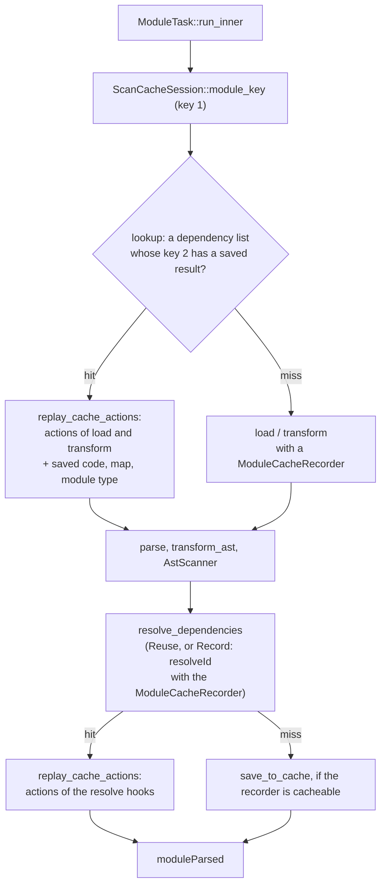
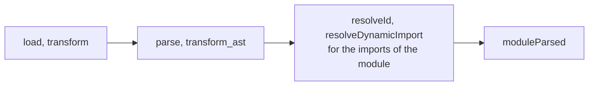
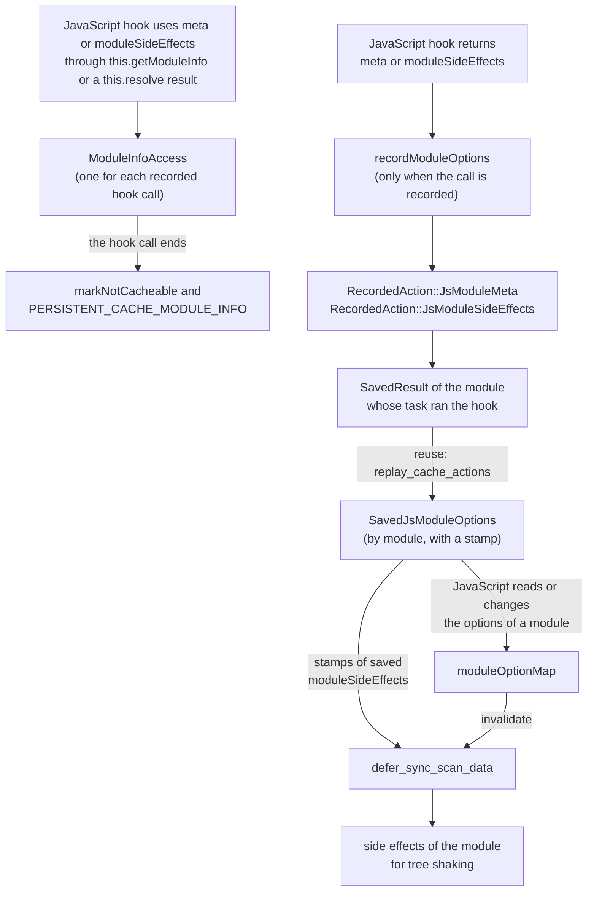
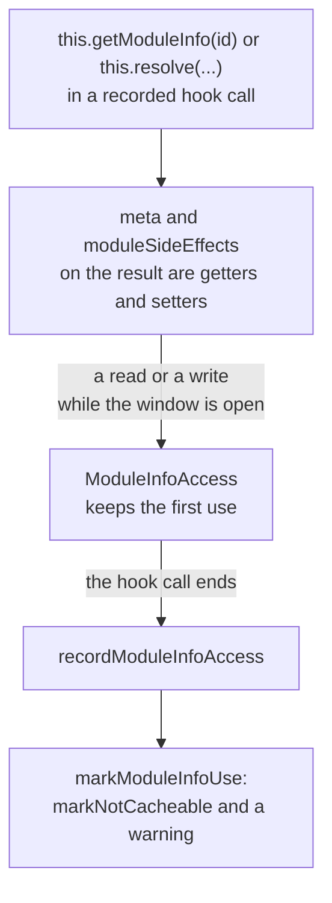
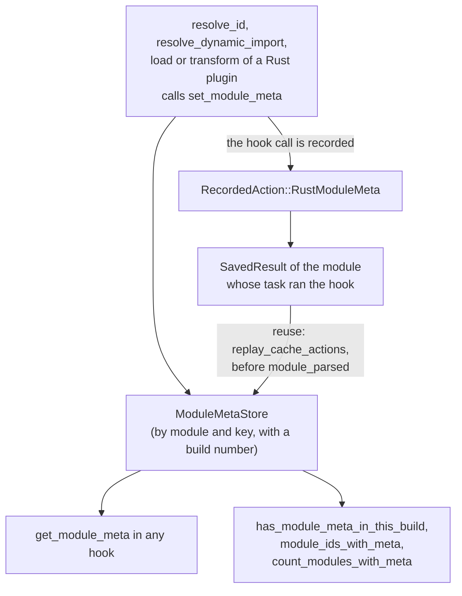

# Persistent scan cache — Implementation

> The design, its rules and its open questions live in the
> [rolldown/cache](https://github.com/rolldown/cache) repository:
> [0002 Persistent scan cache](https://github.com/rolldown/cache/blob/main/design-docs/0002-persistent-scan-cache.md)
> and [0001 Restart validation](https://github.com/rolldown/cache/blob/main/design-docs/0001-restart-validation.md).

## Summary

With `experimental.cache`, each module task saves the result of its `load`,
`transform` and `resolveId` hooks to disk. After a restart, a full scan finds
the saved result of a module by two keys and reuses it: the hooks do not run,
parsing and `moduleParsed` run again. The in-memory `ScanStageCache` and
incremental builds do not change. An incremental build and HMR do not read
saved results, because the scan results in memory are faster; they only save
new ones. A lazy compile (`HmrStage::compile_lazy_entry`) fetches modules that
are not in memory yet, so it reads saved results like a full scan.

## Components

| Concept                                    | Code                                                                                                                          |
| ------------------------------------------ | ----------------------------------------------------------------------------------------------------------------------------- |
| Option `experimental.cache`                | `crates/rolldown_common/src/inner_bundler_options/types/cache_options.rs`                                                     |
| Options hash                               | `options_cache_hash` in `crates/rolldown_common/src/inner_bundler_options/cache_hash.rs`, computed in `prepare_build_context` |
| Per-hook `cache` flag                      | `PluginHookMeta::cache` in `crates/rolldown_plugin/src/types/plugin_hook_meta.rs`                                             |
| Which plugins are cacheable per hook       | `CacheableHooks` in `crates/rolldown_plugin/src/plugin_driver/mod.rs`                                                         |
| Counting the hook calls of a task          | `PluginDriver::check_cacheable_call` in `crates/rolldown_plugin/src/plugin_driver/build_hooks.rs`                             |
| Recording side effects                     | `ModuleCacheRecorder` in `crates/rolldown_plugin/src/types/module_cache_recorder.rs`                                          |
| Replaying side effects                     | `PluginDriver::replay_cache_actions` in `crates/rolldown_plugin/src/plugin_driver/mod.rs`. See [Replaying](#replaying)        |
| JavaScript-side values after a reuse       | `SavedJsModuleOptions` in `crates/rolldown_common/src/types/saved_js_module_options.rs`                                       |
| Recording and taking them in JS            | `recordModuleOptions`, `syncSavedModuleOptions` in `packages/rolldown/src/plugin/plugin-context-data.ts`                      |
| Uses through module info or `this.resolve` | `ModuleInfoAccess` in `packages/rolldown/src/plugin/module-info-access.ts`                                                    |
| Persistent cache warnings                  | `logPersistentCacheModuleInfo`, `logPersistentCacheUnsavableMeta` in `packages/rolldown/src/log/logs.ts`                      |
| Assigned `moduleSideEffects`               | `defer_sync_scan_data` in `crates/rolldown/src/module_loader/deferred_scan_data.rs`                                           |
| Which `meta` values can be saved           | `toSavableMetaEntries` in `packages/rolldown/src/plugin/savable-meta.ts`                                                      |
| Module meta of Rust plugins                | `ModuleMetaStore` in `crates/rolldown_plugin/src/types/module_meta_store.rs`                                                  |
| Setting and reading that meta              | `PluginContext::set_module_meta` and the methods after it in `crates/rolldown_plugin/src/plugin_context/plugin_context.rs`    |
| Keys, lookup, save, flush                  | `PersistentScanCache`, `ScanCacheSession` in `crates/rolldown/src/persistent_cache/mod.rs`                                    |
| Saved result format                        | `SavedResult` in `crates/rolldown/src/persistent_cache/saved_result.rs`                                                       |
| Files on disk                              | `CacheStore` in `crates/rolldown_cache_store`                                                                                 |

## Lifetimes

- `PersistentScanCache` lives in `BundleFactory`. It holds the open
  `CacheStore`. Watch mode and the dev engine keep it across rebuilds.
  `ClassicBundler` creates a factory for each build, so it opens the store each
  time.
- `ScanCacheSession` lives for one scan. `ScanStage::scan` and the two HMR
  loaders in `hmr_stage.rs` create it with `start_scan`. It holds key 1 without
  the module part, and the state of each file that the scan has read, so each
  file is read once per scan.
- `ModuleCacheRecorder` lives for one module task, and only when the task can
  get a saved result and did not find one.
- `SavedJsModuleOptions` lives in `BundleFactory`, as long as the bundler. It
  exists only with the cache. It is not cleared on a full build. See
  [Module meta and `moduleSideEffects` of JavaScript plugins](#module-meta-and-modulesideeffects-of-javascript-plugins).
- `ModuleMetaStore` lives in `BundleFactory`, as long as the bundler. It
  exists also without the cache. It is never cleared. See
  [Module meta of Rust plugins](#module-meta-of-rust-plugins).

## Recording

The driver forks the plugin context for each hook call of a recorded task
(`PluginContext::fork_for_call`), so every context method can reach the
recorder: `add_watch_file`, `emit_*`, `associate_module_with_file_ref`,
`set_module_meta`, the log methods and `load`. `LoadPluginContext` and
`TransformPluginContext` also record transform dependencies. A nested
`this.resolve` passes the recorder on through `resolve_id_check_external`.

So a path that a `load` or `transform` hook gives to `addWatchFile` is stored
three times: as a `WatchFile` action and as a `TransformDependency` action in
the saved result, and in the dependency list under key 1. On the lobehub
benchmark, these copies take less than 1% of the cache size. The cache keeps
all three.

A JavaScript hook reaches Rust through the same forked context:
`BindingTransformPluginContext::inner` returns it. What Rust cannot see, the
JavaScript side reports with these methods of `BindingPluginContext`:

| Method                      | The JavaScript side calls it for                                                                                                                                                                                                                       |
| --------------------------- | ------------------------------------------------------------------------------------------------------------------------------------------------------------------------------------------------------------------------------------------------------ |
| `markNotCacheable`          | `this.markNotCacheable()`, `this.load`, a log that is not JSON, a returned `meta` that cannot be saved, a use of `meta` or `moduleSideEffects` through `this.getModuleInfo` or a `this.resolve` result, a `moduleSideEffects` that a wrapper passes on |
| `recordLog`                 | A log sent to `onLog`                                                                                                                                                                                                                                  |
| `recordModuleOptions`       | The `meta` and the `moduleSideEffects` that a hook returned                                                                                                                                                                                            |
| `ignoreNextHookSideEffects` | A `moduleSideEffects` that a `load` or `transform` wrapper passes on, and that the saved result already holds                                                                                                                                          |

The JavaScript side also asks `isCacheRecording`: whether the cache records
this hook call.

A recorded JavaScript log is replayed as a `Log` with only `js_log_json` set.
The `onLog` wrapper on the JavaScript side passes the parsed object on.

A hook of a parallel plugin never has the cache on:
`ParallelJsPlugin` reports `cache: Some(false)` for its four cacheable hooks
(`never_cached` in `crates/rolldown_binding/src/options/plugin/parallel_js_plugin.rs`).
So `check_cacheable_call` gives a module no saved result when such a hook is
called for it.

## Replaying

A module task that runs its hooks works in this order:

`transform_ast` and `moduleParsed` also run on reuse. They must find the same
state as in a build without the cache. So a saved result keeps its actions in
two lists, and `ModuleTask::run_inner` replays each list at the place of the
hooks that it stands for:

| List                           | Actions of                                                    | Replayed                                            |
| ------------------------------ | ------------------------------------------------------------- | --------------------------------------------------- |
| `SavedResult::actions`         | `load`, `transform`, and the `this.resolve` calls inside them | Before the module is parsed                         |
| `SavedResult::resolve_actions` | The resolve hooks for the imports of the module               | After `resolve_dependencies`, before `moduleParsed` |

When `load_source` returns, the module task reads
`ModuleCacheRecorder::action_count`. `save_to_cache` splits the recorded
actions at this number. Inside a list, the actions keep their recorded order.

For example, `a.js` imports `./b.js`. The `resolve_id` hook of a Rust plugin
sets a meta value for `b.js`. The `transform_ast` hook of the same plugin
reads that value when it gets `a.js`. Without the cache, `transform_ast` runs
before `resolve_id`, so it reads nothing. On reuse, the value is in
`resolve_actions`, so `transform_ast` reads nothing again, and `moduleParsed`
of `a.js` reads the value.

## Module meta and `moduleSideEffects` of JavaScript plugins

The JavaScript side keeps the `meta` and its own copy of `moduleSideEffects`
of each module in `PluginContextData.moduleOptionMap`. `this.getModuleInfo`
reads them from there. Rust does not hold them. A skipped hook cannot write
them, so the cache saves them and gives them back.

The rules for these values are in
[0002 Module meta](https://github.com/rolldown/cache/blob/main/design-docs/0002-persistent-scan-cache.md#module-meta)
and in [0003 Module info in cached hooks](https://github.com/rolldown/cache/blob/main/design-docs/0003-module-info-in-cached-hooks.md).
The cache saves only the values that a hook returns. A hook call that uses
the values through `this.getModuleInfo` or a `this.resolve` result gives its
module task no saved result.

For example, the `transform` hook of `a.js` returns
`meta: { icons: ['home'] }`. Rust records one `JsModuleMeta` action:
module `a.js`, key `icons`, JSON text `["home"]`. After a restart, the task of
`a.js` reuses its saved result. `replay_cache_actions` puts the action into
`SavedJsModuleOptions`. Later `renderChunk` calls `this.getModuleInfo('a.js')`.
The JavaScript side takes the value, parses it, and writes it into
`moduleOptionMap`.

**Recording.** `recordModuleOptions` gets the same values that the hook
wrapper passes to `updateModuleOption`. So the cache saves exactly what the
hook call writes into `moduleOptionMap`:

| Hook                   | Module that the values belong to       | `moduleSideEffects` is written when |
| ---------------------- | -------------------------------------- | ----------------------------------- |
| `load`, `transform`    | The module of the task                 | It is not `null` or `undefined`     |
| `resolveId`            | The module that the import resolves to | It is not `null` or `undefined`     |
| `resolveDynamicImport` | The module that the import resolves to | It is `true` or `'no-treeshake'`    |

All actions go into the saved result of the module whose task ran the hook.

**Uses through `this.getModuleInfo` and `this.resolve`.** A hook can read or
change `this.getModuleInfo(id).meta`, and read or assign
`this.getModuleInfo(id).moduleSideEffects`. It can do the same on the result
of `this.resolve`. `id` can be the module of the hook call or another module.
With the cache, the wrappers of the four cacheable hooks create one
`ModuleInfoAccess` for each hook call (`startModuleInfoAccess` in
`bindingify-build-hooks.ts`, `callCacheableHook` in `cacheable-hook-call.ts`).
It is the recording window of the hook call. It is open until the hook call
ends, and it keeps the first use.

These properties tell `ModuleInfoAccess` about a use:

| Property            | On                                                                                                         | A use is                          |
| ------------------- | ---------------------------------------------------------------------------------------------------------- | --------------------------------- |
| `meta`              | A module info (`proxyModuleInfo`) and a `this.resolve` result (`trackResolvedMeta`). Both use `trackMeta`. | A read or a write                 |
| `moduleSideEffects` | A module info (`proxyModuleInfo`)                                                                          | A read or an assignment           |
| `moduleSideEffects` | A `this.resolve` result, also when `moduleOptionMap` has no value (`trackResolvedSideEffects`)             | A read before the hook assigns it |

The getters are on the module info and on the resolve result, not on `meta`.
They tell `ModuleInfoAccess` only while the window is open and the cache
records the hook call (`openAccess`). A hook call that never reads `meta`
pays nothing more. The call `this.getModuleInfo(id)` alone is not a use.

The properties stay enumerable. So a spread, a rest destructuring or
`JSON.stringify` of the object calls the getters, and it counts as a use.
A use after the hook call ended does not count: `close` ends the window, and
`ModuleInfoAccess.use` then does nothing. The examples of both cases are in
[0003 Caveats](https://github.com/rolldown/cache/blob/main/design-docs/0003-module-info-in-cached-hooks.md#caveats).

When the handler returns no promise, the hook call has ended when it returns.
`callAndRecord` then closes the window at once, so code that runs during its
`await` does not count.

When the hook call ends, `recordModuleInfoAccess` gives the first use to
`markModuleInfoUse`. It marks the module task as not cacheable and prints
`PERSISTENT_CACHE_MODULE_INFO`. See [Warnings](#warnings).

Without the cache, `startModuleInfoAccess` returns `undefined`, and
`callCacheableHook` returns the result of the handler directly. It is not an
`async` function, so a build without the cache awaits the same value as with
a direct call of the handler.

**A returned `this.resolve` result.** A `resolveId` hook can return the
result of `this.resolve` as it is. The wrapper reads `meta` and
`moduleSideEffects` of the returned object after the window closed, so the
getters do not count these reads. Three checks cover them:

- `meta`: the returned object holds the `meta` object of the resolved module.
  `updateModuleOption` copies the object into itself, so the hook sets
  nothing. `recordModuleOptions` saves nothing for it
  (`meta !== this.moduleOptionMap.get(key)?.meta`), and the module task keeps
  its saved result.
- `meta` of another module: `PluginContextData.metaHolders`, a `WeakMap`,
  holds the modules of each `meta` object (`addMetaHolder`). When a hook
  returns a `meta` object that another module holds, for example a
  `this.resolve` result with a changed `id`, `recordModuleOptions` counts a
  use of `meta`. It does the same when the target module shares its current
  `meta` object with another module. Without the cache, the objects stay
  shared.
- `moduleSideEffects`: `PluginContextData.resolvedSideEffectsFromMap`, a
  `WeakSet`, holds each `this.resolve` result whose `moduleSideEffects` came
  from `moduleOptionMap`. An assignment to the property removes the result
  from the set. A result without a value from the map is not in the set, so
  returning it as it is does not count. The wrappers of `resolveId` and
  `resolveDynamicImport` check the returned object with
  `isResolvedSideEffectsFromMap`. A match calls `markSideEffectsPassedOn`, so
  the module task gets no saved result, also when the value is the same as
  the one from the resolver.

**`moduleSideEffects` that a wrapper passes on.** The wrappers of `load`,
`transform` and `resolveId` return the `moduleSideEffects` in
`moduleOptionMap` to Rust when the hook itself returned none:

- `load`, `transform` (`passOnModuleSideEffects`): when an earlier `load` or
  `transform` hook of the same module returned the value in this build, the
  saved result already holds it. The wrapper calls
  `BindingPluginContext::ignoreNextHookSideEffects`, and the next
  `ModuleCacheRecorder::record_hook_side_effects` call does nothing. In every
  other case, no hook of this module task returned the value in this build,
  and the wrapper calls `markSideEffectsPassedOn`.
- `resolveId`: the value comes from another hook call, so the wrapper calls
  `markSideEffectsPassedOn`.

`markSideEffectsPassedOn` marks the module task as not cacheable, as
`markModuleInfoUse` does, but prints no warning. The hook is written in the
usual way, and the plugin cannot know which value to return instead.

`PluginContextData.ownSideEffects` holds the modules of the first case.
`updateModuleOption` adds a module when a `load` or `transform` hook of the
module returns `moduleSideEffects`. Any other write of the value removes the
module, and so does `applySavedModuleOptions`. `clear` empties the set after
each `generate` and `write` (`invalidate_js_side_cache` in
`crates/rolldown/src/bundle/bundle.rs`).

For `resolveId`, whether `moduleOptionMap` has a value can depend on the
order in which module tasks run. So the number of reused modules can change
from build to build. See the example in
[0003 Caveats](https://github.com/rolldown/cache/blob/main/design-docs/0003-module-info-in-cached-hooks.md#caveats).

**Values that cannot be saved.** `toSavableMetaEntries` turns the `meta` that
a hook returned into one entry for each top-level key, or says that the
`meta` cannot be saved. It checks the rule in
[0002 Module meta](https://github.com/rolldown/cache/blob/main/design-docs/0002-persistent-scan-cache.md#module-meta).
Three parts of the rule have reasons in the code:

- The `meta` object itself must be a plain object. When the module has no
  `meta` yet, `updateModuleOption` keeps the object of the hook as the `meta`
  of the module. So `info.meta` would be a `Map` when the hook runs, and a
  plain object after a reuse.
- A top-level key must be well-formed UTF-16, because Rust holds it as
  UTF-8.
- A top-level key with the value `undefined` gets an entry without JSON
  text. `updateModuleOption` writes `undefined` over an older value of the
  key, so a reuse does the same.

The check runs only when `BindingPluginContext::isCacheRecording` is true. A
`meta` that cannot be saved marks the module task as not cacheable and prints
`PERSISTENT_CACHE_UNSAVABLE_META`. See [Warnings](#warnings).

**Giving the values back is pull, not push.** Rust does not call JavaScript
for each reused module. The JavaScript side takes the values at these points:

| Point                                                                                                   | How it gets the values                                                                      |
| ------------------------------------------------------------------------------------------------------- | ------------------------------------------------------------------------------------------- |
| `this.getModuleInfo`, the result of `this.load`, `moduleParsed`, `getModuleInfo` of `manualChunks`      | `BindingModuleInfo::savedModuleOptions`                                                     |
| The result of `this.resolve`                                                                            | `savedModuleOptionsStamp` on the result, then `BindingPluginContext::getSavedModuleOptions` |
| A hook wrapper, before it writes a hook result                                                          | `BindingPluginContext::getSavedModuleOptions`                                               |
| `this.load`, before it writes its `meta` and `moduleSideEffects` options                                | `BindingPluginContext::getSavedModuleOptions`                                               |
| An assignment to `moduleSideEffects` on the result of `this.getModuleInfo`, before the value is written | `BindingPluginContext::getSavedModuleOptions`                                               |

The result of `this.resolve` carries only a stamp. A `meta` value can be
large, and a plugin can resolve the same module many times.

**Stamps.** Each value in `SavedJsModuleOptions` has a stamp, a number that
grows over the whole process. The JavaScript side keeps the newest stamp that
it has written for each module (`appliedSavedStamps`), and asks only for
newer values. So a value is written one time.

**Order.** A saved value is older than the result of a hook that runs in the
same build. So a hook wrapper takes the saved values of a module before it
writes the hook result into the options of that module
(`updateModuleOptionFromHook` in
`packages/rolldown/src/plugin/bindingify-build-hooks.ts`). For example, the
saved result of `a.js` holds `meta: { key: 1 }` for `c.js` from `resolveId`.
`c.js` changed, so its `transform` hook runs and returns `meta: { key: 2 }`.
Without this step, a later read would write `1` over `2`.

**Lifetime.** `SavedJsModuleOptions` keeps at most one value for each `meta`
key of a module, and one `moduleSideEffects` value. A new value replaces the
old one. The values stay as long as the bundler lives: a plugin can read a
module for the first time in any later build, also in an incremental build in
which the module runs no task.

**Order of the keys.** A replaced `meta` key keeps its place in the list of
its module, and the JavaScript side writes the keys in list order. This is
what `Object.assign` does when the hooks run, so `Object.keys(meta)` and
`JSON.stringify(meta)` give the same result. For example, one `transform`
hook of `a.js` returns `meta: { shared: 1, other: 2 }` and a later one
returns `meta: { shared: 3 }`. The list is `shared`, `other`, with the value
`3` for `shared`. The stamps in the list are then not sorted, so each module
keeps its newest stamp in a separate field (`ModuleOptions::newest_stamp`).

### Warnings

A module task that loses its saved result for one of these reasons prints a
warning:

- `PERSISTENT_CACHE_MODULE_INFO`: a use through `this.getModuleInfo` or a
  `this.resolve` result. The message names the use
  (`PersistentCacheModuleInfoUse` in `packages/rolldown/src/log/logs.ts`).
- `PERSISTENT_CACHE_UNSAVABLE_META`: a returned `meta` that cannot be saved.

A `moduleSideEffects` value that a wrapper passes on, or that a returned
`this.resolve` result holds, prints no warning (`markSideEffectsPassedOn`, see
**`moduleSideEffects` that a wrapper passes on** above).

Only a hook call that the cache records prints them (`isCacheRecording`).
The warning names the module of the task that loses its saved result:
`ModuleCacheRecorder` keeps it, and JavaScript gets it with
`BindingPluginContext::cacheModuleId` (`warnedModuleId`). A hook that runs
inside `this.resolve` uses the recorder of the task that called
`this.resolve`, so its importer can be another module.
`PluginContextData.warnOnce` prints each code once for each plugin and hook.
The code is part of the key in `warnedCacheLogs`, so one warning does not
hide the other. `warnedCacheLogs` is never cleared, so "once" holds for the
life of one `PluginContextData`. `createBundlerOptions` makes one for each
`generate` or `write` call of a `rolldown()` build, one for each output of a
watcher, and one for a dev engine. The rule is in
[0002 Module meta](https://github.com/rolldown/cache/blob/main/design-docs/0002-persistent-scan-cache.md#module-meta).

### Assigned `moduleSideEffects`

An assignment to `this.getModuleInfo(id).moduleSideEffects` writes the value
into `moduleOptionMap` with `invalidate` set. No hook result holds it.
Rolldown gets it after the scan: `defer_sync_scan_data` calls the
`deferSyncScanData` callback, which returns the modules whose options have
`invalidate` set. The cache never saves an assignment: in a recorded hook
call, an assignment gives no saved result. A hook call that the cache does
not record can still assign.

After a reuse, a `moduleSideEffects` that a hook returned is in
`SavedJsModuleOptions`, and Rolldown already has it from the saved result.
The JavaScript side takes it only when something reads the module. Until
then, an older assignment in `moduleOptionMap` still has `invalidate` set. So
`defer_sync_scan_data` passes the saved values with their stamps to the
callback (`SavedJsModuleOptions::side_effects`).
`PluginContextData.deferSyncScanData` leaves out each module whose saved
value has a newer stamp than the applied one. Every write to the map takes
the saved values first, so that saved value is also newer than the value in
the map. For the other modules, it returns what the map says: the value if
`invalidate` is set.

For example, in watch mode, the `transform` hook of `b.js` returns
`moduleSideEffects: false`. In one build, a hook of `c.js` that the cache
does not record assigns `true` on `b.js`. The map then holds `true` with
`invalidate`. In the next build, `c.js` no longer assigns, and `b.js` reuses
its saved result. The callback gets
`[{ id: 'b.js', stamp: 12, sideEffects: false }]`, with a stamp that is newer
than the applied one. So it returns nothing for `b.js`, and Rolldown keeps the
`false` from the saved result.

Without the persistent cache, the list is empty.

## Module meta of Rust plugins

A Rust plugin has its own meta for each module: bytes under a key, for a
module. `ModuleMetaStore` holds it. It is separate from the `meta` of
JavaScript plugins: JavaScript never reads it, and `ModuleInfo` does not hold
it.

| Method of `PluginContext`                       | What it does                                                       |
| ----------------------------------------------- | ------------------------------------------------------------------ |
| `set_module_meta(module_id, key, value)`        | Replaces the value under `key` of the module. The other keys stay. |
| `get_module_meta(module_id, key)`               | The value, from this build or from an earlier one.                 |
| `has_module_meta_in_this_build(module_id, key)` | Whether the value under `key` of the module was set in this build. |
| `module_ids_with_meta(key)`                     | The modules whose value under `key` was set in this build.         |
| `count_modules_with_meta(key)`                  | The number of these modules. It makes no copy of the ids.          |

`LoadPluginContext` and `TransformPluginContext` have the same methods,
because they give access to their `PluginContext`. The module id is the id
that the hooks get, for example `args.id` in `transform`. On a
`PluginContext::Napi`, which has no bundler, `set_module_meta` does nothing
and the read methods find nothing.

For example, the `transform` hook of Vite's reporter plugin
(`crates/rolldown_plugin_vite_reporter/src/lib.rs`) calls
`ctx.set_module_meta(args.id, "builtin:vite-reporter", [1u8])`. In the first
build, the hook runs for `a.js`. The store gets the value, and the saved
result of `a.js` gets one `RustModuleMeta` action. After a restart, the task
of `a.js` reuses its saved result, so `transform` does not run.
`replay_cache_actions` sets the value again. In `build_end`,
`count_modules_with_meta("builtin:vite-reporter")` counts `a.js`, as in a
build without the cache.

The progress line of the reporter counts a module in `transform`, as without
the cache. `transform` also runs for the runtime module, which gets no
`module_parsed`. A reused module runs no `transform`, so `module_parsed`
counts it. It counts only a module that has the mark of this build
(`has_module_meta_in_this_build`) and that `transform` did not count in this
build (`reported_in_transform`, cleared in `build_start`).

**Saving.** `NativePluginContextImpl::set_module_meta` records the call when
the context has a recorder. The context of a `resolve_id`,
`resolve_dynamic_import`, `load` or `transform` call of a recorded module
task has one. So the action goes into the saved result of the module whose
task ran the hook, also when the value is for another module. A call in
another hook, for example `module_parsed`, changes the store and is not
saved.

**Reuse.** The value of a `load` or `transform` call is set again before the
module is parsed. The value of a resolve hook is set again after the imports
are resolved. Both are there when `module_parsed` runs. See
[Replaying](#replaying).

**Lifetime.** The store is not cleared at the start of a module task and not
between builds, like `moduleOptionMap` on the JavaScript side. A store made
in `create_plugin_driver` would be lost at every build, so `BundleFactory`
owns it and passes it to each new plugin driver, as it does with
`transform_dependencies`.

`moduleOptionMap` is not cleared between builds, also without the cache. So
a module keeps `meta` keys and `moduleSideEffects` of an earlier build of the
same bundler ([rolldown/rolldown#11223](https://github.com/rolldown/rolldown/issues/11223)).
A fix that clears `moduleOptionMap` between builds must also clear
`PluginContextData.appliedSavedStamps`. Otherwise `syncSavedModuleOptions`
asks only for values that are newer than the old stamps, and the saved values
are not written back into the empty map. For example, `a.js` reuses its
saved result, and the JavaScript side applies its `meta` with stamp 5. In a
later build, `a.js` runs no task, so no newer stamp comes. With the map
cleared and stamp 5 kept, `renderChunk` reads no `meta` for `a.js`.
`ownSideEffects` needs no change: `clear` already empties it after each
`generate` and `write`.

**The modules of this build.** A value can be from an earlier build of the
same bundler, and its module can be gone from the graph. So each value keeps
the number of the build that set it last. `create_plugin_driver` takes a new
number from `ModuleMetaStore::start_build`: each plugin driver is one build,
full or incremental. `has_module_meta_in_this_build`,
`module_ids_with_meta` and `count_modules_with_meta` look only at values that
have the number of this build. A hook set such a value in this build, or
`replay_cache_actions` did. `get_module_meta` does not look at the number.

For example, a bundler in watch mode makes a full build after each change.
`main.js` imports `a.js` and `b.js`, and the reporter prints "4 modules
transformed": the three files and the runtime module. A user removes the
import of `b.js`. The next build sets the mark of `main.js`, `a.js` and the
runtime module again, and prints "3 modules transformed". The mark of `b.js`
is still in the store, with the number of the first build.

In an incremental build, only the changed and the new modules run a module
task. So these methods give only those modules, as the `transform` hook runs
only for them.

## Writing

`save` puts the encoded result into the store's pending data. At the end of a
scan, `start_flush` writes the pending data on a background thread while the
build links and generates. `Bundle::write`, `generate` and `scan` wait for it
before they return, so a one-time build does not exit first. Incremental
builds and HMR do not wait. The next scan or `Bundler::close` waits and
prints a failed write as a warning; `Drop` only waits.

`CacheStore::flush` writes one new segment file. It never copies large
segments: it only merges many small ones, and copies a segment for `maxAge`
only when at least half of its data is expired.

## Invariants

- A saved result is only added, never changed. A changed input gives other
  keys, so old data is not found. `maxAge` and segment merging in
  `CacheStore` are the only removals.
- A saved result is reused as a whole or not at all: if a `package.json` that
  its resolve results name cannot be read, the module runs its hooks.
- When a build dependency changes while a bundler runs, the cache is off for
  that bundler: its options and plugins come from the old build dependency.
- Any data that cannot be read or decoded is "not found". No cache error fails
  a build; a failed write prints a `PERSISTENT_CACHE_WRITE_FAILED` warning.
- With native MagicString and sourcemaps, `PersistentScanCache::new` returns
  `None`: part of the sourcemap chain is added after the module task.
- The runtime module specifier is never saved in resolve results. A saved
  result without a key for an import falls back to resolving it normally.
- `SAVED_RESULT_FORMAT` in `saved_result.rs` grows with every change to the
  saved format, so a result in an older format is not found. Its value is
  `9`. The action tags `11` and `12` in `write_action` and `read_action` are
  not used.

## Related

- [`../cache/implementation.md`](../cache/implementation.md) — the in-memory caches, including `ScanStageCache`
- [`../options/design.md`](../options/design.md) — how options flow from JavaScript to Rust
